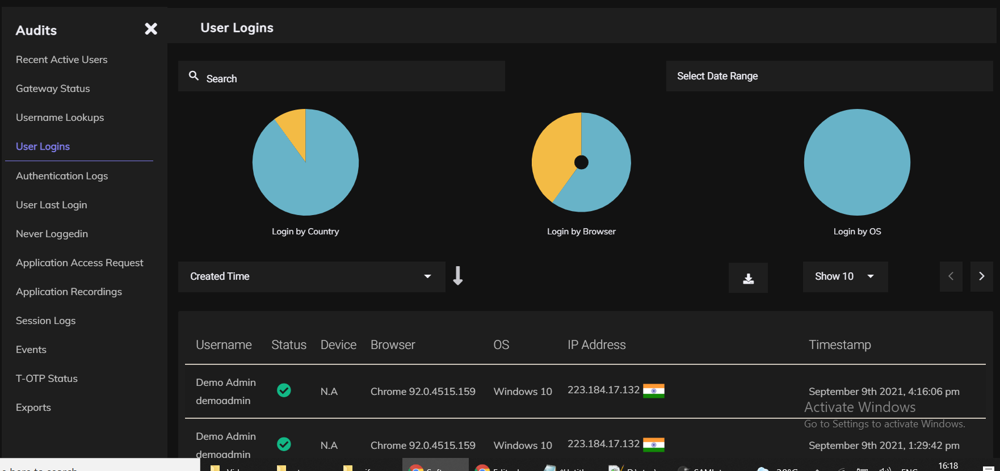

## Audit Logs

Instasafe provides  pre-built and pre-configured user activities, system operations, and security events reports that can be downloaded.

For efficient monitoring and compliance ZTAA  collects and maintains a large range of logs and reports. The different logs and reports available under Audit Section of the Dash board are:-

- Recent Active Users
- Gateway Status
- Username Lookups
- User Logins
- Authentication Logs
- User Last Login
- Never Loggedin
- Application Access Request
- Application Recordings
- Session Logs
- Events
- T-OTP Status
- Exports

To download a report, Click on the download button.

ZTAA has around 107 events including System events, Admin events and User events that can be downloaded. Few are mentioned below for reference:

| Event Type | Event |
| ------ | ------ |
|    Admin    |   User Update     |
|   Admin   |   User Delete |
|   Admin   |   User Role Update|
|   System     | User Credentials verification       |
|   System     |  Primary SAML authentication      |
|   System     |   AD sync Updates     |
|   User    |   User Token refresh  |
|   User    |   Device Register |
|   User    |   User set Password |

### Exporting a Log

