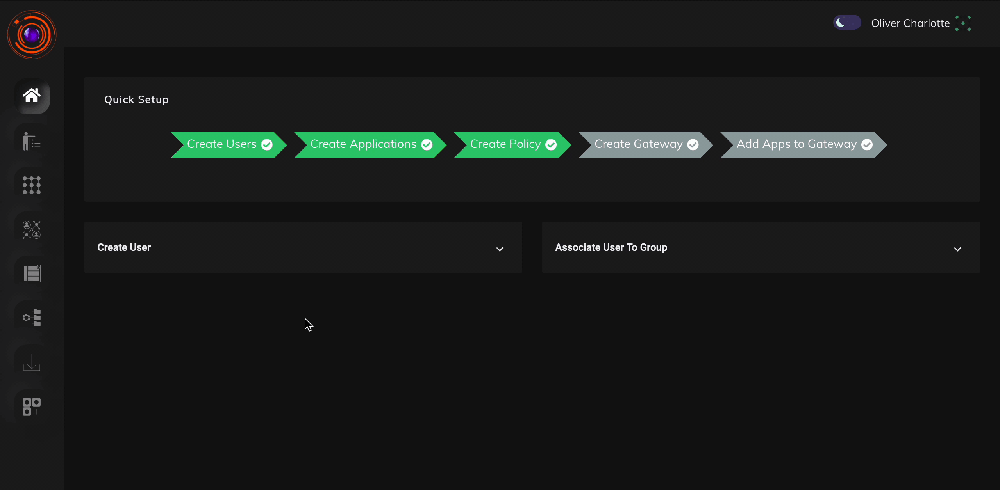

ZTAA supports creation of advanced security rules which can control access based on device security posture. Advanced security checks such as Application Access Time, Operating System, Antivirus,location details etc. can be configured using data management features. Dataset created here will be used in access control list to configure rules.

### Creating a Dataset

1. To create dataset, go to configuration section of the console and click on Data Management.

2. Click on create a new Dataset. Fill the details and select Parameter/Variable you want to create data set for.

ZTAA currently supports the following types of parameters using which dataset can be created. 
These  are

* AntiVirus Enabled Name

* AntiVirus Installed Name

 * AntiVirus Updated Name
 * Country
 * DateTime
 * Mac Address
 * OS Build Version
 * OS Family
 * OS Main Version
 * OS Minor Version
 * System Domain Name
 * Location
 * Serial no
 * Serial number 
 * Geolocation
 * IP or Domain
 * Time Based Access
 * Certificate
 * Register
 * Encryption

3. Click on "Create Dataset" button.

Details  on creating a data set can be seen in the video below. 

