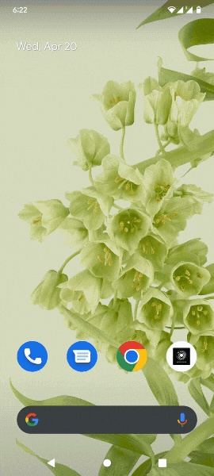
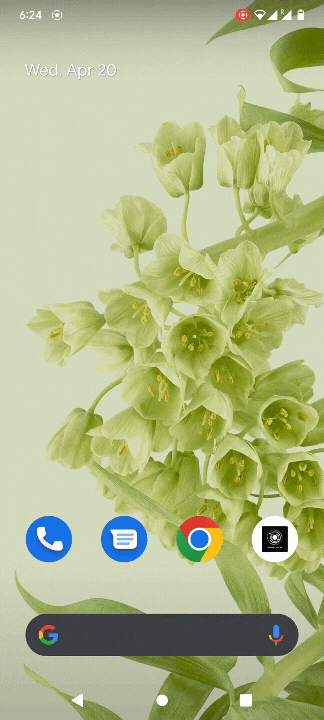

Instasafe ZTAA supports integration with a wide range of authenticator applications. The user can configure Instasafe Authenticator or any other authenticator application suitable to the user. An authenticator application serves as an alternative to OTP received by mail or SMS and ensures users are able to conveniently login. 

#### Configuring Instasafe Authenticator

Instasafe Authenticator works with Instasafe Zero Trust secure access control solutions to make logins more secure, by adding an additional factor of biometric based verification. Simple push notification-based approval along with biometric authentication to provide simple, yet convenient and robust access control for your workforce. Our Zero trust solutions ensures that your applications are protected from unauthorized access, so that you can focus on doing what you do best.  

| Application Specification | Details |
| ------ | ------ |
|Current Version | 1.1.7 |
| Supported OS | Android 6.0 +, IOS 9.0 + |
| Permissions Required |  Camera, Flashlight, Biometric Hardware, Network Connections, Receive Data from Internet,  Read google service configuration  |

	
** Setting Up Authenticator application **

**Downloading and Installing the Application**

1. The Instasafe Authenticator application can be installed from the Google Playstore/Apple Appstore.

**Setting up your Profile**

1. If you are installing the application for the first time, you will see a slider screen upon initiation.
Click on Authenticate Button.
 
2. Set up your MPIN. The MPIN will be used as an alternative to Fingerprint authentication.
 
3. You will be asked to verify your Fingerprint/MPIN and upon successful verification be taken to the home screen.

4. Click on the button at the bottom right to add your profile.

5. Select a ISA/ZTAA profile and enter your company’s domain name.

6. Enter your username and password and received "SMS OTP".

 
Once your Identity is successfully verified, your profile will be added and displayed on the home screen.

 
**Subsequent Login**

P.S. The following steps are applicable once the Instasafe Authenticator application is installed in a device and Auth Profile for the user has been set up.
1. Login to the Console/ Agent.

2. You will receive an Alert Stating Push Notification has been Sent.

3. Click on the Push Notification and Authenticate via Fingerprint/MPIN.

	 

#### Configuring any  authenticator by Scanning QR code.

User can configure any other application such as Google authenticator or Microsoft authenticator to be used with ZTAA.

Please follow the steps below for configuring authenticator application.

1. Go to **Set up authenticator** option under **My profile**.

2. Scan the QR code with the authenticator application.

3. Enter the 6 digit code obtained in the application  in the **OTP** field of ZTAA console and click on Verify.

4. After successful verification the application is ready to be used with ZTAA.

5. You can verify by trying to logging in into the application with the OTP from authenticator application.

