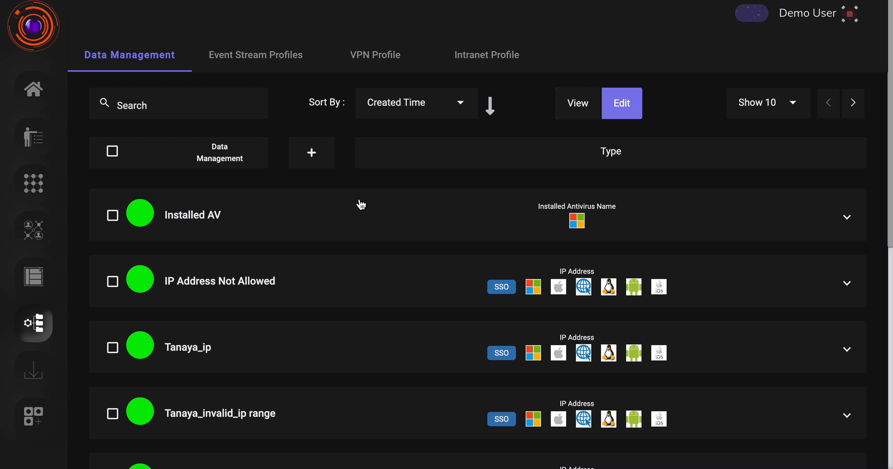

The zero trust security framework authorizes both users and devices before enabling access to critical applications. Under the tenets of zero trust, only verified devices and users are granted access to assets, applications and systems.
Device posture is a measurement of how secure and compliant the device is. By monitoring and enforcing device posture, organizations can prevent malicious devices from accessing sensitive information and critical applications.

InstaSafe captures all the required information of the device and stores against the user.InstaSafe also verifies the device parameters each time user logs in.

InstaSafe ZTAA empowers administrators to ensure that only devices that comply with predefined security policies can access the enterprise applications from the agent.

**Device posture attributes available in ZTAA**

* AntiVirus Enabled Name
* AntiVirus Installed Name
* AntiVirus Updated Name
* Mac Address
* OS Build Version
* OS Family
* OS Major Version
* OS Minor Version
* System Domain Name
* System MacAddress
* System Serial number

Implementation of Device posture check in ZTAA is a two step process:

1. Create a device posture profile dataset.
2. Add the device posture profile dataset in Access Policy.

**Create Device posture profile in ZTAA**

To create a device posture profile dataset in the ZTAA console follow the below steps:

1. Click on “Configuration” in the left menu.
2. Navigate to the “Data Management” tab.
3. Click on the “+” icon to create a new dataset.
4. Select the device posture attribute available in the “Select Variable” dropdown.
5. Enter the Dataset name and description click on “Add Dataset”.
6. Search for the created Dataset and click on Edit.
7. Click on the “Records” and add a record value.

**Apply Device posture profile in Access Policy**

To assign a device posture dataset to access policy perform the below steps:

1. Click on “Access Policy” in the left menu.
2. Search for the access policy to which you would like to add a device posture dataset.
3. Select the Access Policy and click on Edit.
4. Navigate to the “Manage Rules” tab.
5. Click on the “+Rule” and select the device posture attribute.
6. Select the device posture profile dataset and click on “Update Manage Rules”.

After the above configurations are performed, users when they login to the ZTAA agent will not have access to the applications to which they are granted access to if their device does not comply with the configured device posture profile.
