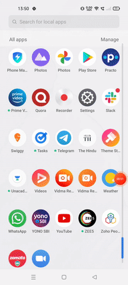
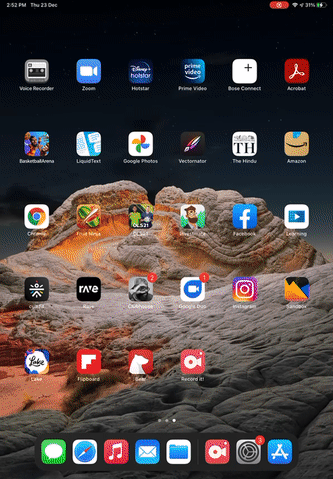

ZTAA is supported in all latest versions of Android and IOS. Once the user successfully sets his profile password he can downlaod the agent from the console and install it on his device. Applictions to which the user has access to can be accessed  through the agent.

#### Android Installation 

ZTAA client is available on android playstore as **Instasafe 4T Ready Client**. Please follow the below mentioned steps for installing the agent on an android device.

1- Open Google playstore and search for  **Instasafe 4t Ready Client**.

2- Open the application page and click on Install.

3-  Once installation is complete open the application and login with your credentials.

4- ZTAA client setup on your android device is now complete.

#### IOS Installation 

ZTAA client is available on apple appstore as **Instasafe 4T Ready Client**. Please follow the below mentioned steps for installing the agent on an android device.

1- Open apple appstore and search for  **Instasafe 4t Ready Client**.

2- Open the application page and click on Install.

3-  Once installation is complete open the application and login with your credentials.

4- ZTAA client setup on your IOS device is now complete.

