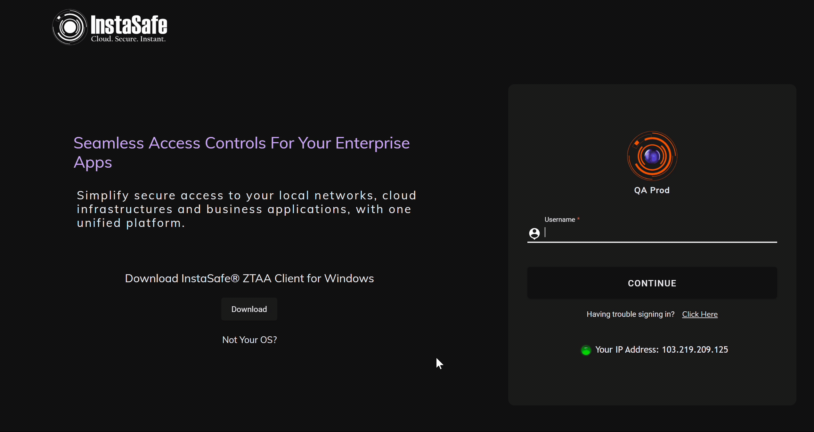

#### Windows Installation

ZTAA is supported in all latest versions of Windows. Once the user successfully sets his profile password he can downlaod the agent from the console and install it on his device. Applications to which the user has been granted access can be accessed from the agent.

Please ensure the following prerequisites are installed on your system prior to installing

| Operating System | Build | Architecture | Pre-Requisites |
| ------ | ------ | ------ | ------ |
| Windows 7 | 7600 |64 Bit | [Service Pack 1](https://storage.googleapis.com/electronbuild-updates/dependencies/x64/windows6.1-KB976932-X64.exe) (manual installation) |
| Windows 7 SP1| 7601 | 64 Bit |  - [Windows Hotfix KB2921916](https://storage.googleapis.com/electronbuild-updates/dependencies/x64/Windows6.1-KB2921916-x64.msu) (auto installation)    - [Windows Hotfix KB4457144](https://storage.googleapis.com/electronbuild-updates/dependencies/x64/windows6.1-kb4457144-x64_5ca467d42deadc2b2f4010c4a26b4a6903790dd5.msu) (auto installation)   - [Wireguard](https://www.wireguard.com/install/) (auto installation)   |
| Windows 8+ | Any | Any | - [Wireguard](https://www.wireguard.com/install/) (auto installation) |

**Follow these steps to install the agent.**

1.  Login to the cconsole and go to the download section.

2.  Download the agent for your OS.

3.  Run the downloaded exe file.

4.  Allow access through firewall  antivirus blocking if any.

5.  Once installation is complete enter your domain/Username/Password information in the agent.

6.  Your agent is now successfully configured.

