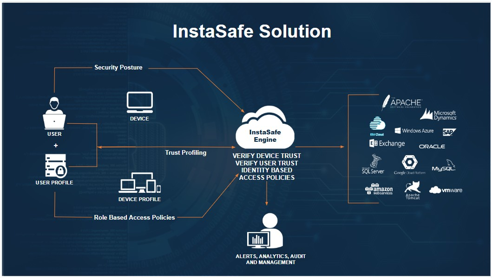
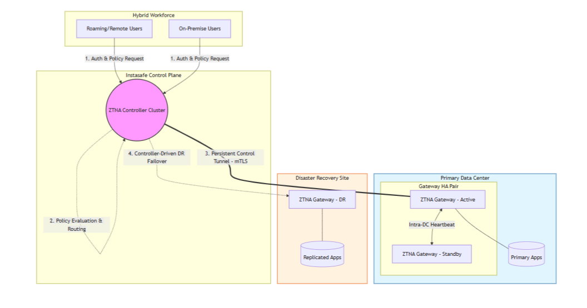

# **ISA Components**

The InstaSafe Secure Access (ISA) Architecture consists of 3 components

1. Controller
1. Gateway
1. User Agent

DC to DR switch 

## **Controller**

InstaSafe Controller is one of the key modules in the InstaSafe Cloud infrastructure that enforces access control for network connectivity. It is also the central point to which InstaSafe User Agent and Gateway Agent establish independent DTLS tunnels. It enforces policies and accepts/denies application access based  on the configured policies. 

The Controllers are provisioned in multiple cloud providers in various geo locations. The Controllers are strategically placed as close as possible to customer premises to ensure minimum latency Each tenant requires the provisioning of one or more Controllers. 

The Controller IP and the port number is pushed to the ISA Agent in the configuration file, after authentication and compliant checks are successfully completed.  In the context of ISA User Agents, the Controller's role commences after the User Agent successfully completes authentication, Geo Location check, Device Binding check, Device Check, and secondary authentication, such as 2FA/MFA. 

The Controller listens on the IP address and the TCP or UDP port for tunnel establishment requests. The ISA Agents initiates the connection to the Controller and the Controller identifies the organization based on the signature in the first UDP packet it receives and proceeds to establish the tunnel. 

The Controller is responsible for tasks such as: 
- Allocate IP addresses and routes to the ISA User Agent.
- Route data between the Agent and the private network
- Enforce security policies.

## **Gateway**

InstaSafe Secure Access (ISA) Gateway Agent is a software that acts as the entry and exit point for user access. It is responsible for encrypting and decrypting data sent over the secure connection, as well as routing data between the ISA User Agent and the private network. The ISA Gateway Agent establishes a DTLS tunnel with the ISA Controller to route traffic between the User Agents and the private network. 

Gateways are deployed at the edge of a private network, and are used to connect remote clients or networks to the private network. It can also be used to connect two separate private networks together, such as in site-to-site configuration.

The Gateway Agent script or installation file contains the following relevant information:

- Client certificate 
- Client private key
- CA certificate to verify the server certificate 
- Static key for HMAC operation
- Domain name and port number of the Controller 

The ISA Gateway Agent connection establishment process:

- The Agent makes an outbound connection to the domain name of the Controller on the port number in the configuration file. 
- Agent establishes a DTLS tunnel with the Controller after mutual authentication using the certificates and static key in the configuration file.  
- Data traffic from the User Agents is routed through the tunnel via the Controller to the Gateway, decrypted, and forwarded to the corporate resource. 

## **User Agent**

The ISA User Agent is a software that is installed on users’ devices, such as laptops or smartphones. The Agent connects to the ISA Cloud Delivery Platform for the authentication and authorisation process. 

Once successfully authenticated, the Agent establishes a DTLS tunnel with the ISA Controller to access the remote network. The Agent runs as a service in the user computer. The agent can be configured to auto-connect whenever the computer is turned on.

# Agent-Based Access – Step-by-Step Flow

The following section describes the sequence of operations involved in providing secure access to private applications using the ISA User Agent, Controller, and Gateway.

## Phase 1: User Authentication

1. The **InstaSafe User Agent** initiates a connection to the InstaSafe Web Console.

2. The user provides credentials for authentication.

3. The authentication workflow includes:
    - User credential validation  
    - Geo-location validation  
    - Device binding verification  
    - Device compliance check  
    - Secondary authentication (2FA/MFA), if enabled  

4. Upon successful verification, the Controller pushes the following information to the Agent:
    - Controller IP address  
    - Port number  
    - Organizational configuration details  

Only after successful authentication and compliance checks does the Controller proceed with tunnel establishment.

## Phase 2: DTLS Tunnel Establishment (User Agent ↔ Controller)

5. The User Agent initiates a DTLS tunnel request to the Controller using the configured IP and port.

6. The Controller:
    - Identifies the organization based on the signature in the initial packet  
    - Performs mutual authentication  
    - Establishes a secure DTLS tunnel  
    
7. Upon successful tunnel establishment, the Controller:
    - Allocates a virtual IP address to the User Agent  
    - Pushes routing information  
    - Applies applicable security policies  

## Phase 3: Gateway Tunnel Establishment (Gateway ↔ Controller)

8. The Gateway initiates only outbound connections to the Controller. No inbound ports are opened on the customer firewall for application access.

9. Mutual authentication is performed between the Gateway and Controller.

10. A secure DTLS tunnel is established between the Gateway and Controller.

## Phase 4: Policy Enforcement & Traffic Routing

11. When the authenticated user attempts to access a private application:

    - The User Agent sends traffic through its DTLS tunnel.
    - The Controller evaluates policies based on:
       - User identity  
       - Group membership  
       - Device posture  
       - Configured access rules  

12. If access is permitted:
    - The Controller routes traffic through the secure tunnel to the Gateway.
    - The Gateway decrypts the traffic.
    - Traffic is forwarded to the intended private application.

13. Return traffic follows the reverse secure path:
    - Application → Gateway  
    - Gateway → Controller (DTLS)  
    - Controller → User Agent (DTLS)  

## Phase 5: Secure Application Access

14. The user securely accesses the authorized private application.

15. Private applications remain in internal networks and are never exposed to the public internet.

16. All traffic:
    - Remains encrypted end-to-end  
    - Is policy-controlled  
    - Is restricted only to permitted applications  

No direct inbound access to private applications is required at any point.

This process ensures secure, policy-driven, identity-based access to private resources without exposing internal infrastructure.

