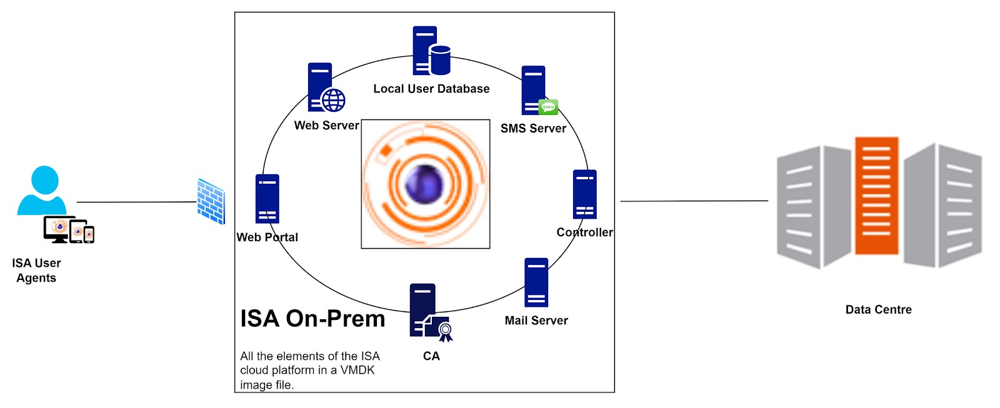
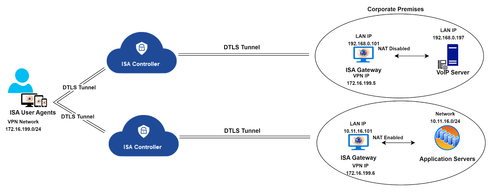

# **Instasafe Secure Access(ISA) Gateway**

**Gateway**

<!-- **InstaSafe Gateway Pre-requisites** -->

InstaSafe Secure Access (ISA) Gateway is a software that acts as the entry and exit point for the user access. It is responsible for encrypting and decrypting data sent over the secure connection, as well as routing data between the Client and the Private Network. Gateways use DTLS protocol to establish and secure the connection. 
Gateways are deployed on the edge of a private network, and are used to connect remote clients or networks to the private network. It can also be used to connect two separate private networks together, such as in a site-to-site configuration. 

## **VM Sizing**

An ISA Gateway must be provisioned on a physical server or VM at each of the data centres where applications are hosted. To ensure redundancy, it is recommended to provision a backup Gateway as well. This ensures that unforeseen issues (like hardware failure or OS corruption) do not lead to downtime.

|  |  |
| ------ | ------ |
|  OS    |  Ubuntu 20.04 LTS - Ubuntu 22.04 LTS (https://ubuntu.com/download/server)      |
|  OS Type      |  64-bit      |
|   RAM         |   Minimum 2GB |
|   Hard Disk   |   Minimum 10GB of free space |
|   CPU         |   1 x Dual Core processor (x64 based AMD)|

## **Network Prerequisites**

The ISA Gateway in each data centre must have network access to the internal applications you wish to provide secure remote access to. Here are the Firewall Rules that might need to be created:

| Source | Destination | Port   |   Direction   |
| ------ | ------ | ------      |   ------      |
|  ISA Gateway      |    13.234.13.233, 3.6.62.25, 13.234.125.194, 3.6.127.45  |  UDP Port*   |   Outbound    | 
|  ISA Gateway     |   35.154.170.140     |    TCP 443 |   Outbound       |

**IP Addresses**  are **Ports** are unique to every deployment and shall be provided by the InstaSafe Tech Team

**IP Protocol Support:** The platform supports IPv4 and IPv6 addresses both for gateway communication and application access.

Full internet access must be provided at the time of installation so that relevant packages and repositories could be downloaded. It is recommended to provide direct internet access instead of via proxy.

## **ISA Agent**

InstaSafe Secure Access (ISA) Agent refers to a software that is installed on a user's device, such as a laptop or smartphone. The agent establishes and provides data confidentiality over the secure connection.
The Agent runs as a service in the user computer. The agent can be configured to auto-connect whenever the computer is turned on.

The agent facilitates  the  following operations:

- User Authentication
- Device Authentication
- Device Compliance
- Dynamic Routing and Addressing
- Secure Channel Establishment for Data traffic.

ISA Agent is installed on the host (Windows, Linux, Mac, Android or IOS). The end user logs in to Instasafe web portal and downloads and executes the setup program.
The Configuration file contains the following information:

- Cloud controller(s) IP address and ports to which ISA will connect.
- ISA client certificate & private key.
- CA Certificate for validating server cert during the connection establishment phase. 
- Tls Authentication Shared Key.
- User-specific configurations.

The installer installs the Tunnel adapter interface in the windows client machine which ISA uses as the Tunnel Interface.

The ISA Agent supported OS are:

**Windows: 32/64 Bit**

- Windows 7/8/10/11

**Mac**

- Ventura 13.2.1/13.3
- Monterey
- Mountain Lion and Above

**Linux : 64 Bit**

- Ubuntu 18/20/22
- Peppermint
- Debian
- redhat
- Amazon Linux
- Suse
- CentOS

**Mint**

- Mint 19.1/19.2/19.3/20/20.1/20.2/20.3

**Mobile : Android / iOS**

- Android 5 and Above
- iOS 13 and Above

## **ISA On-Prem Deployment**

InstaSafe Secure Access (ISA) on-premises deployment extends the capabilities of the InstaSafe Cloud Delivery Platform (ICDP) into the customer's on-premises infrastructure. This will integrate InstaSafe enterprise remote access software solution into their corporate network.

**Key Technical Features**

**VMDK Image File:** A Virtual Machine Disk (VMDK) image file is provided to customers.

**Resource Allocation:** The image is pre-configured with 4 CPU cores, 4 MB memory, and 8 GB storage, with the option to expand storage as required. 

**Comprehensive Feature Set:** The image incorporates all basic features available in the ISA cloud infrastructure. Additional features are enabled based on customer specifications prior to sharing the image file.

**Unified Controller and Gateway:** In on-premises deployments, the ISA Controller and Gateway operate as a unified entity, performing the roles of both. The option to add a Controller is eliminated as the Controller is already incorporated within the image file. 

**Components Hosted Within the Image**

**Web Portal:** Accessible within (and outside of) the on-premises environment, providing a centralized interface for managing secure access.

**Web Server:** Facilitates secure communication between users and the ISA deployment.

**Authentication Server and Database:** Manages user authentication securely with an integrated database for streamlined access control.

**Controller:** Manages access control and data connection between the remote uses and the Gateway.

**PKI Server:** Provides Public Key Infrastructure for encryption and authentication.

**Mail Server and SMS Server:** Manages multi-factor authentication through email and SMS, enhancing overall security.

**Conclusion**

ISA on-premises deployment provides a comprehensive and integrated secure enterprise remote access solution customised as per customer requirements.

## **Twin Tunnel Configuration in ISA Deployment: A Technical Overview**

The twin tunnel configuration is an advanced setup designed for specific circumstances within the ISA deployment framework. In the standard ISA deployment, a single ISA Controller serves as a conduit between remote users and the corporate resources they aim to access. InstaSafe strategically provisions the Controller based on proximity to the customer environment, aiming to minimize traffic latency. Resource allocation for the Controller, including processing power, memory, storage, and bandwidth, is calculated considering factors such as customer requirements, user base, and the nature of accessed resources.

However, in certain network environments, the nature of the traffic traversing the tunnel may require the deployment of multiple Gateways to ensure optimal traffic flow.

In the described scenario, where traffic is segregated by deploying two Gateways to route specific types of traffic, the processing burden on a single Controller may lead to operational overhead, potentially impacting traffic flow quality. To address this, the solution involves provisioning two Controllers in addition to the two Gateways, ensuring the seamless flow of traffic.

Twin Tunnel Configuration Diagram:

Results of the twin tunnel configuration implementation:

**Controller Provisioning:** Two Controllers are provisioned and configured in the backend system.

**User Profile Configuration:** Users intended for the twin tunnel connection must have the twin tunnel option enabled in their user profiles on the web portal.

**Agent Installation:** ISA User Agent installation on each end-point device includes

- Two Agent configuration files
- Two InstaSafe services
- Two virtual Tap/Tun Adapters (one for each Controller)

**Tunnel Establishment:** The Agent establishes a tunnel with each Controller, with one tunnel dedicated to voice traffic and the other for data traffic, aligning with the scenario illustrated in the diagram.

This twin tunnel configuration provides a solution for specific network scenarios, ensuring optimized traffic flow and resource utilization.

## **Active-Active and Active-Passive Deployment**

**Active and Passive Modes**

**Active Mode** - When the Controller status is Running, the Controller is in active mode. In this state, the controller is actively performing its designated functions, tasks, or processes, and it is ready to receive and respond to input, commands, or requests. This status indicates that the Controller is actively engaged in its role and is available for its intended purposes.

**Passive Mode** - When the Controller status is Stopped, the Controller is in passive mode. In this state, the Controller is not actively performing its designated functions, tasks, or processes. It is temporarily inactive, not responsive to input, commands, or requests, and is essentially on standby or in a state of rest. The Stopped status implies that the Controller is not actively engaged in its role at that moment, and is not currently available for its intended purposes.

**Active-Passive Deployment**

In deployments demanding high availability for all critical systems, ISA can be configured in Active-Passive mode to ensure redundancy. In such setups, multiple Controllers are deployed across distinct cloud servers, each configured with identical network sizes and port numbers.

For example, when an active Controller is deployed in Cloud Server A with a 10.10.0.0/16 network and listening on UDP port 1355, a passive Controller is simultaneously deployed in Cloud Server B with the same 10.10.0.0/16 network and listening on UDP port 1355. In the event that Cloud Server A needs to be shut down, the Controller in Cloud Server B can be manually activated, providing a manual active-passive deployment mechanism. When Cloud Server A is shut down, users connected to the Controller deployed therein will be disconnected and must be reconnected to the new Controller in Cloud Server B. 

**Active-Active Deployment** 

In deployments where the user count exceeds 1000, a strategy of deploying multiple Controllers is employed to effectively distribute the load. For instance, if there are 5000 users, five Controllers are deployed to ensure optimal performance and efficient resource utilization.
