# Devices

Devices are objects created either automatically or manually containing certain information about the client computers that connect to the ISA web console. When a client that has the ISA User Agent installed connects to the web console, Instasafe Secure Access (ISA) automatically captures certain information and creates an object with this information. Device objects can also be manually created.  

On the Devices page under DEVICES & CHECKS on the left-side menu of the ISA web console, you can view the following information 

Devices: List of devices either captured automatically or manually added. Each device object has the following information:

1. Name – The name of the object. The name could either be automatically created or manually set. If automatic, the name is the concatenation of the username of the remote user, the string “device”, and a number separated by underscores. The number represents the number of devices this user has connected with. For example, user_device_1. 
2. MAC Address – This is the address of the physical network adapter of the connecting client. This allows for the identification of the client by its hardware or MAC address. 
3. Operating System Name – The name of the OS as represented within OS. 
4. Serial Number – The host’s BIOS serial number. 
5. UUID – The client computer’s Universally Unique Identifier (UUID) 
6. Status – The status of a device is:

    a.pending-approval

    b.suspended

    c.enabled

7. User ID - Unique identifier of the user associated with the device  
8. Device Model - Hardware model of device  
9. Agent Version - Installed ISA agent version  
10. Owner - User to whom the device is assigned  
11. Profile Name - Device profile applied

When a device is in pending approval or suspended status, if Device Binding is enabled for the user, the user will not be able to connect. The device status must be set to enabled.

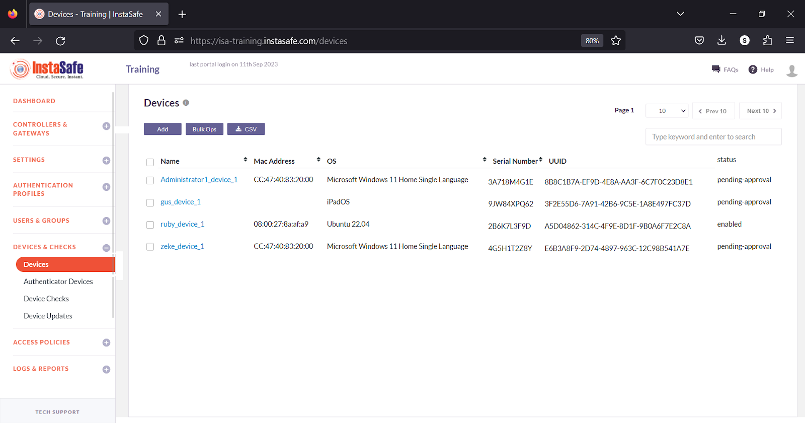

A device can be edited by clicking on its name.  The device status can be set on the Device Details window. To edit the device, click on the Edit button. 

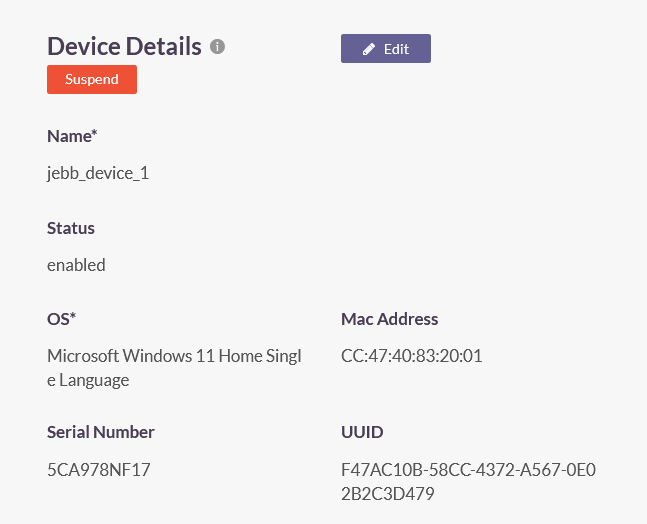

**Add**: Click this button to manually register a device. Enter the following information in this window:

- Name: Enter a name for this device. The name must not have spaces.  Hyphens or underscores are allowed. Maximum characters allowed is 30.
- OS: Enter the OS name. 
- MAC Address: Enter the MAC address of the physical network adapter that connects to the ISA web console. 
- Serial Number: Enter the BIOS serial number of the host.  
- UUID: Enter the UUID of the host.

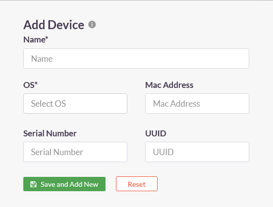

Bulk operations perform activation, suspension, deletion of devices en masse. In the Bulk Operations for Devices window, perform the following actions:

1. Select the bulk operation

    a. Activate – Activate devices

    b. Suspend – Suspend devices

    c. Delete – Deletes devices 

2. Download sample template

    a. Download a sample file in CSV format 

    b. Add the names of the devices into the file

3. Upload the file in the required CSV format 

    a. Choose file – Locate the file with device names in CSV format

    b. Upload – Upload the file to activate, suspend, or delete the devices in the file

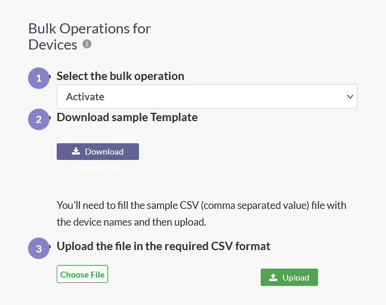

**CSV:** Download the list of devices in CSV. When clicked, an email will be sent to the logged-in administrator’s email address with the link to download the file. This file can also be used for bulk operations. 

**Page View:** You can navigate the list by selecting the page number from the drop-down list.

**Keyword search box:** Search for a device by entering a keyword of the device name, MAC address, OS name, or UUID. 

## **Device Check**

InstaSafe Secure Access (ISA) allows administrators to define rules that check endpoint devices for mandatory compliances. These rules determine whether a device is allowed to connect. As a result, non-compliant endpoints are prevented from accessing corporate resources.

On the ISA web console, administrators can create objects for each type of Device Checks. For more information on configuring Device Checks, refer to Configuring Device Checks for Windows Clients.

| Category | Device Check | Example Check Value | Comments |
| ------ | ------ | ----- | ----- |
| Antivirus | Antivirus | Kaspersky, Symantec | Pattern matching on product name |
|  | AntiVirusStatus | Installed | Checks if antivirus is installed |
|  | AntiVirusStatus | UptoDate | Checks if definitions are up-to-date |
|  | AntiVirusStatus | Enabled | Checks if antivirus is active |
|  | SEPLastAVUpdate | 2025-12-01 | Specific to Symantec Endpoint Protection |
| Anti-Spyware | AntiSpyWare | Product Name | Pattern matching on product name |
|  | AntiSpywareStatus | Installed | Checks if antispyware is installed |
|  | AntiSpywareStatus | UptoDate | Checks if definitions are up-to-date |
|  | AntiSpywareStatus | Enabled | Checks if antispyware is active |
| Firewall | Firewall | Product Name | Pattern matching on product name |
|  | Firewall Status | Installed | Checks if firewall is installed |
|  | Firewall Status | Enabled | Checks if firewall is enabled |
| System | RegistryKeyExists |  |  |
|  | ProcessRunning |  |  |
|  | ProcessNotRunning |  |  |
|  | Client Certificate | Yes / No | Certificate Presence |
| ------ | ------ | ----- | ----- |

**Examples of Device Check**

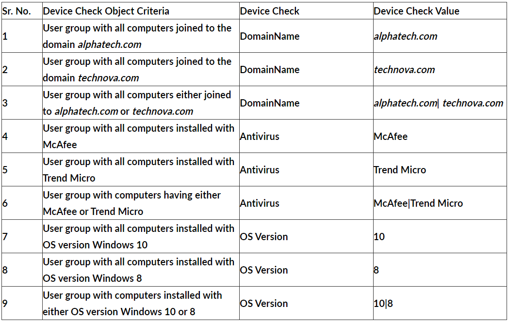

Imagine a scenario where Device Check needs to be performed on a user group with the following criteria:

- Users must have either Windows 8 or Windows 10 OS versions.
- Users must be joined to the 'alphatech.com' domain.
- Users must have either McAfee or Trend Micro Endpoint Protection installed.

To meet these criteria, using the table above, the following Device Checks can be configured for the user group:

(Device Check Object 9) &&

(Device Check Object 1) && 

(Device Check Object 6) 

- && refers to logical AND operation. This means that even if one of the above checks doesn’t hold true, Device Checks will not permit the user to connect the ISA Agent from that device
- _Device Checks can be applied individually for specific users, instead of at the user group level
- _Device Check objects of the same type must be configured with one single rule when applied to a user or user group. For example:
    - To check for installed antivirus software, do not assign two separate Device Check objects to a user or group, one for McAfee and another for Trend Micro. Instead, create a single object with the 'Check Value' set to 'McAfee|Trend Micro' and apply it to the user or user group.

## **Configure Device Checks**

InstaSafe Secure Access (ISA) enables administrators to define rules that check endpoint devices for mandatory compliances. These rules determine whether a device is allowed to connect. As a result, non-compliant endpoints are prevented from accessing corporate resources.

On the ISA web console, administrators can create objects for each type of Device Checks.

Currently the following types of Device Checks can be created:

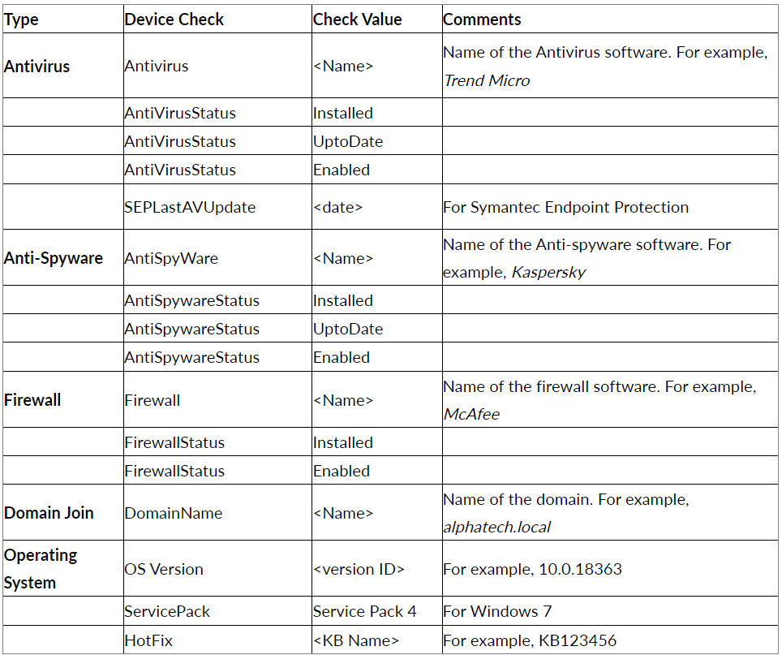

- Device Checks of the same type must be configured by creating one Device Check object with multiple values. For example, the Device Check type of Windows OS version may contain the values 8, 10, or 11. Each value must be separated by the ‘pipe symbol’ as in "8|10|11".
- Once a Device Check object is created, the object must be added to a user or user group.
- When multiple objects are added to a user or user group, the connecting device must meet all the conditions defined in the objects. If the connecting device fails to meet any one of the conditions, the connection will be refused.
- A Device Check object can be created with two values separated by the pipe symbol “|” for OR operation, where either of the conditions must be true.
- When enforcing Device Check on a user or user group multiple Device Check objects, all the conditions must be true. This means that if one of the checks doesn’t hold true, Device Check will not permit the user to connect the ISA User Agent from that device.

For more information on Device Check, refer to Device Check Explained.

- Log into the ISA web console with administrator credentials.
- Navigate to the DEVICES & CHECKS > Device Checks page.

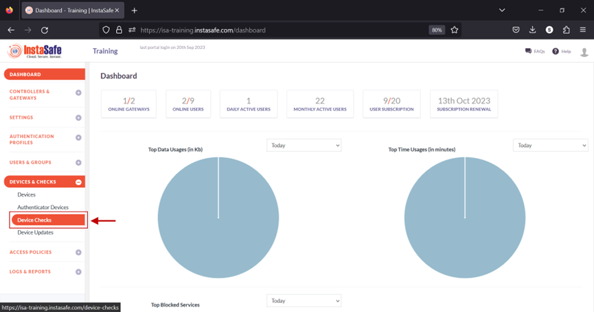

- Click on Add.

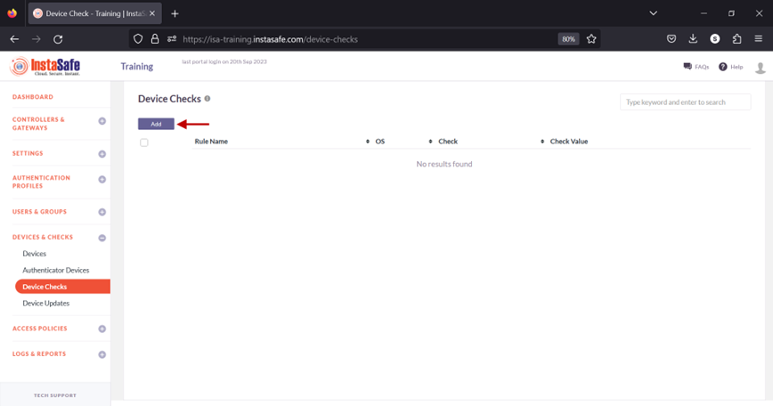

- On the Add device check window, enter the following information:

    a. Rule Name: Enter a name for this object, preferably that which illustrates the condition defined in the object. For example, Windows Version.

    b. OS: click on the drop-down list to select the operating system. In this example, Microsoft Windows.

    c. Check: click the drop-down list to select the condition to check for. For example, OS Version.

    d. Check value: enter the value for the condition defined under Check. For example, 8, 10, or 11. Multiple values can be entered here by separating them with the pipe symbol. 

    e. Click Save and Add New. 

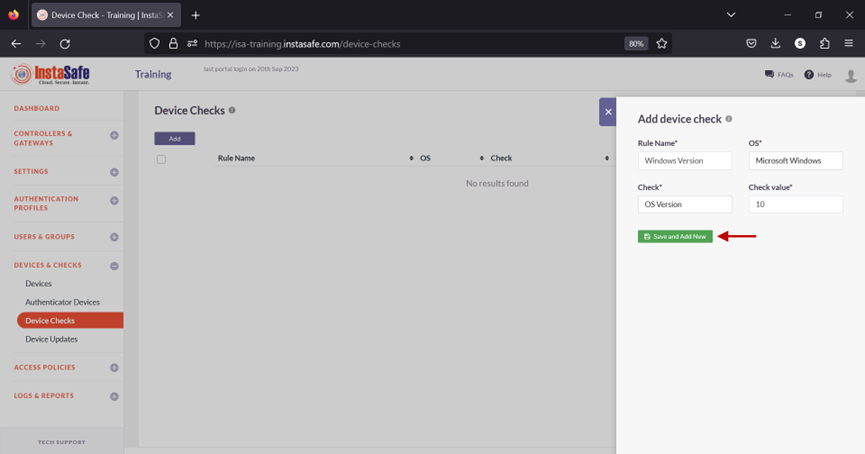

- The new Device Check object has been created.

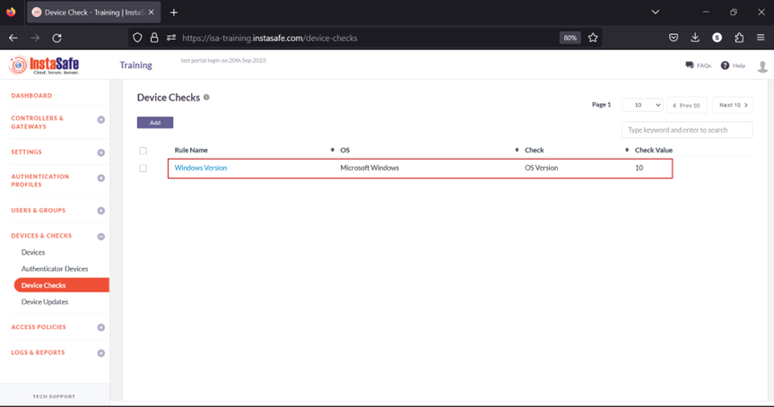

- Navigate to the USERS & GROUPS > Users page.

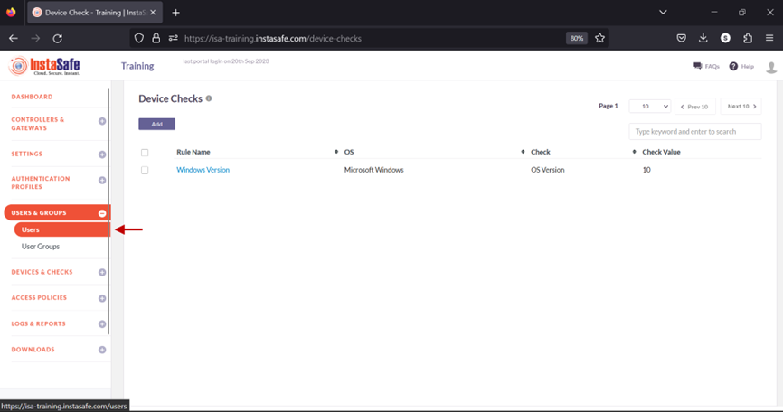

- On the Users page, click on the name of a user to edit it.

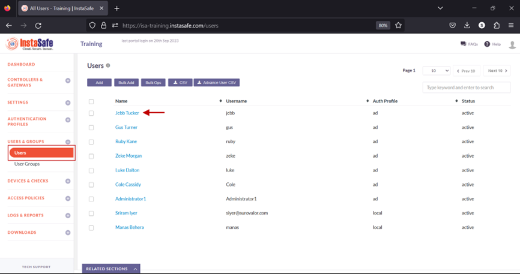

- Click the Edit button.

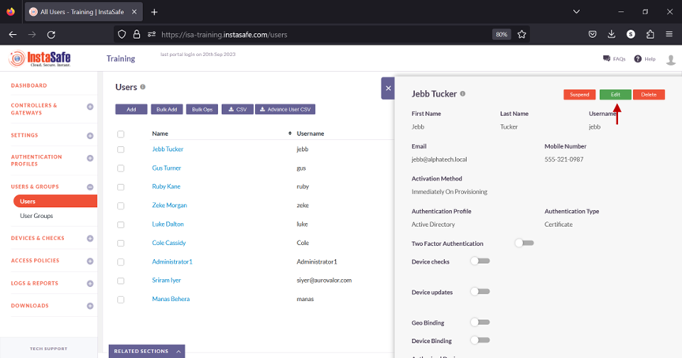

- Scroll Down.

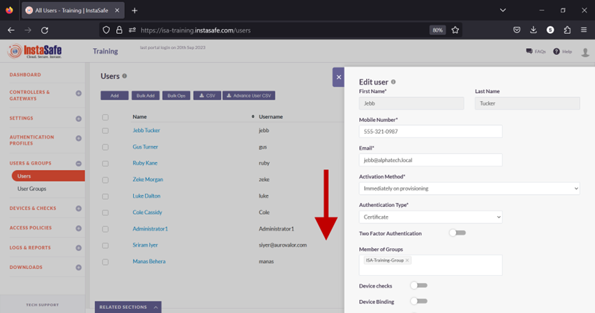

- Toggle the Device checks button to enable it.

- Click inside the Select device checks box. 

- From the drop-down list, select the Device Check object.

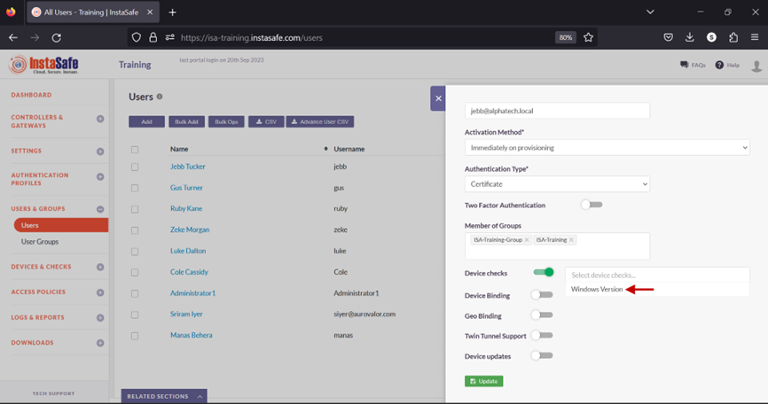

- Click Update at the bottom to save this change.

This user must meet the condition defined in the Device Check object before being able to connect the ISA User Agent successfully. 

**Add a Device Check Object and assign to a user group**

1.Navigate to the DEVICES & CHECKS > Devices page and click the Add button
2.On the Add device check window, enter the following information:

- Rule Name: Enter a name for this object, preferably that which illustrates the condition defined in the object. In this example, Antivirus.
- OS: click on the drop-down list to select the operating system. In this example, Microsoft Windows.
- Check: click the drop-down list to select the condition to check for. For example, Antivirus.
- Check value: enter the name or names of the antivirus software. In this example, Windows Defender|Trend Micro. Since multiple values are entered, they are separated by the pipe symbol. 
- Click Save and Add New. 

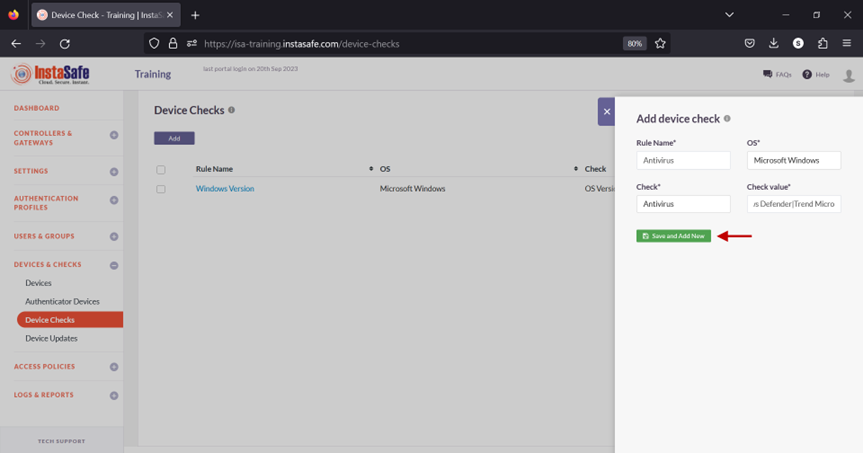

3.The new object will be listed on the page.

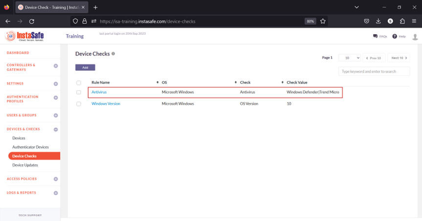

4.Navigate to the USERS & GROUPS > User Groups page.

5.Click on the name of a user group listed here.
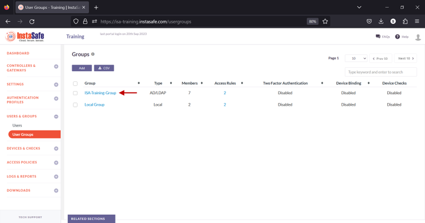

6.In the Group details window, click the Edit button.

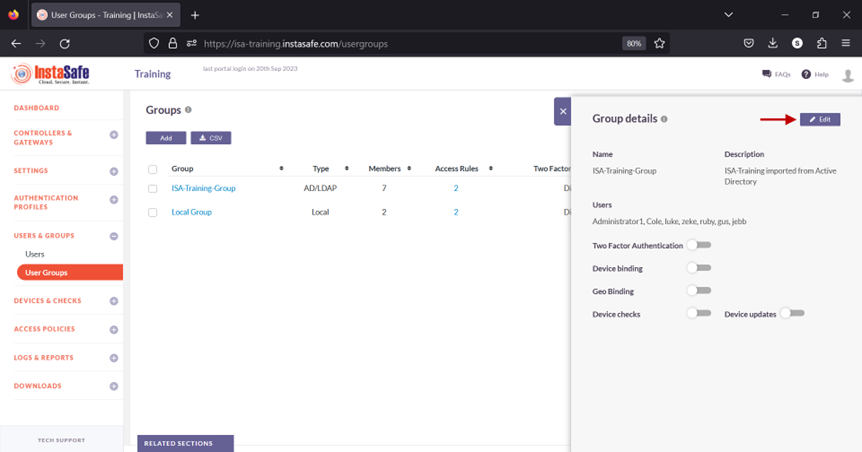

7.Toggle the Device checks button to enable it.

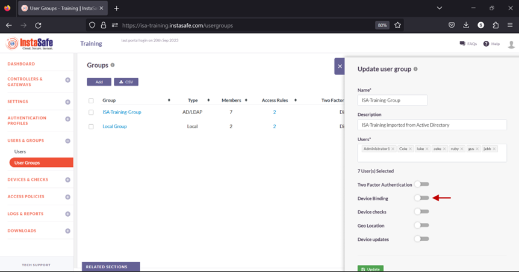

8.Click inside the Select device checks box. 

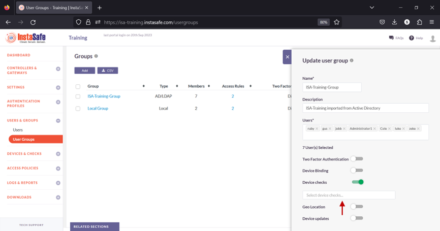

9.From the drop-down list, select the Device Check objects one by one to add it. 

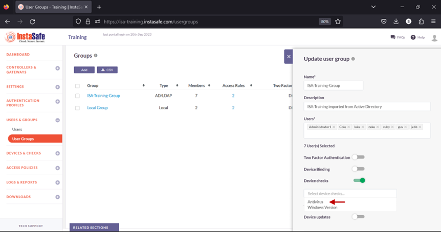

10.Click Update to save the change. 

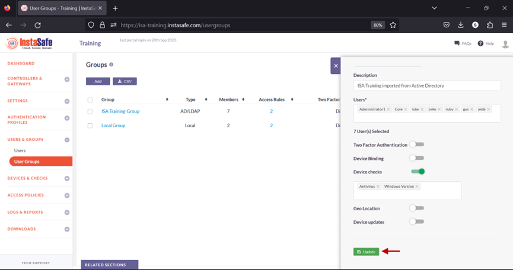

Users in this group must meet all the conditions defined in the Device Check objects before being able to connect the ISA User Agent successfully. If even one of the conditions is not met, the ISA User Agent connection will fail with a similar error message:

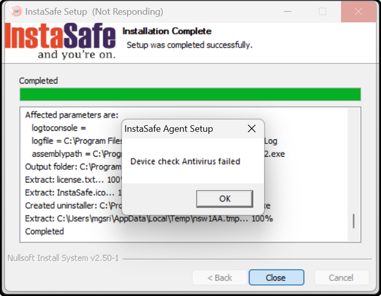

**Examples of other Device Check Failures**

| Domain Name Check Failed | In Domain Check Failed | OS Version Check Failed |
| ------ | ------ | ------ |
| 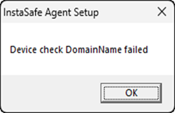 | 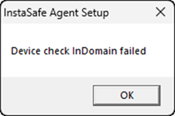 |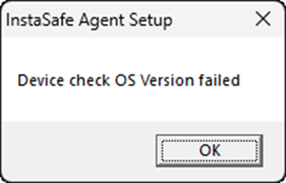 |

**Conclusion**

​Device Check is an effective way to further secure shared resources by forcing the remote end-devices to fulfil certain parameters before remotely accessing them.  

## **Configure Device Binding Automatic**

Device Registration occurs when Instasafe Secure Access (ISA) automatically captures certain device identification details when an ISA User Agent connects to the ISA Controller.  The information captured during Device Registration are:

1. MAC Address of the physical network adapter
2. Operating System Name
3. BIOS Serial Number
4. Universally Unique Identifier (UUID)

The above information is captured irrespective of whether the User Agent is able to successfully connect to the ISA Controller.

Using these parameters, it is possible to enforce Device Binding on users. Device Binding will ensure that the users are allowed to make connections only from those devices registered in the ISA web console. This will eliminate attacks due to stolen or shared passwords. A user can be bound to multiple devices.

In addition to configuring Device Binding using automatically captured parameters, the ISA web console allows admins to register devices manually.  

This article describes the process of configuring Device Binding using automatic Device Registration. 

- Log into the ISA web console using admin credentials
- Navigate to the DEVICES & CHECKS > DEVICES page. 

- The information of automatically captured devices will be listed here. Each device will be listed with their automatically created name. The name is the concatenation of the username of the remote user, the string “device”, and a number separated by underscores. The number represents the number of devices this user has connected with. For example, the user _Ruby_ has connected with one device, an Ubuntu client. If the same user connects from a Windows client, a new entry will be created and listed with an identical name but the number increased to two. For the purpose of this article, we select the device profile name “_ruby_device_1_” and bind it to the user _Ruby_.

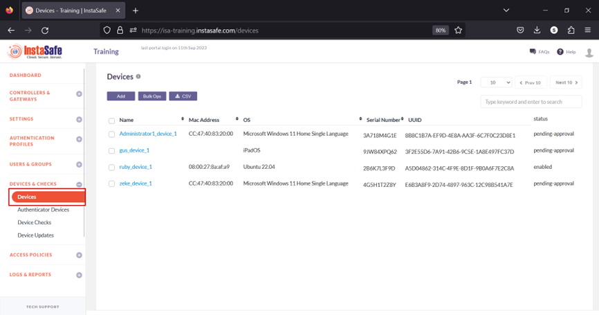

When a user's device information is captured, the default status of the device is Pending Approval. Until the device is approved or activated, if the user or the user group has Device Binding enabled, the user will not be able to connect from the device. Click the name of the device. For updating the statuses of a large number of devices at once, refer to Performing Bulk Operation on Device List.

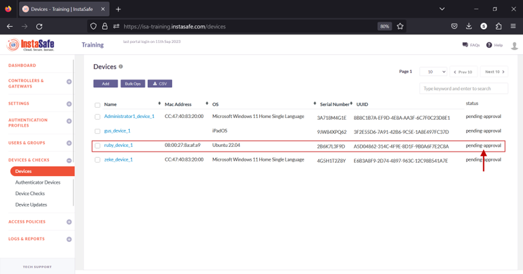

- On the Device Details window, click Activate.

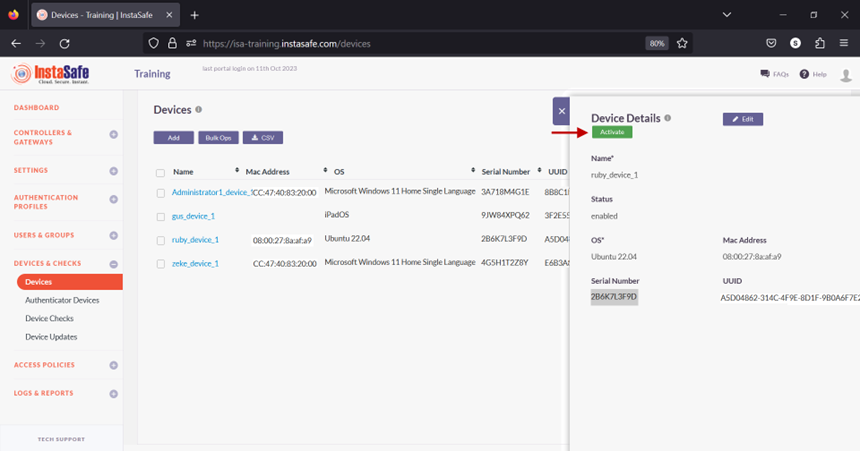

- On the pop-up window, click Yes, Activate it!.

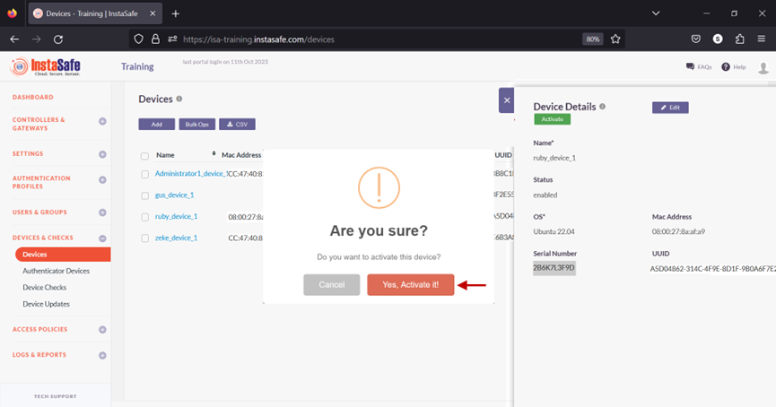

- The device has been activated.

- Navigate to the USERS & GROUPS > Users page.
- On this page, click on the name Ruby Kane

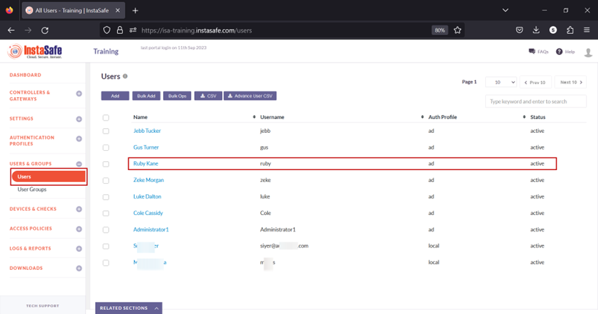

- In the edit user window, click on Edit.

- Scroll down and toggle the Device Binding button to enable it. Then click inside the Select devices box to list the device names. Select the device name for the user. In this example, _ruby_device_1_.

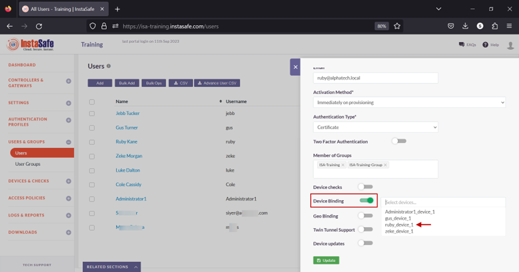

- Click on Update at the bottom to save this configuration. 

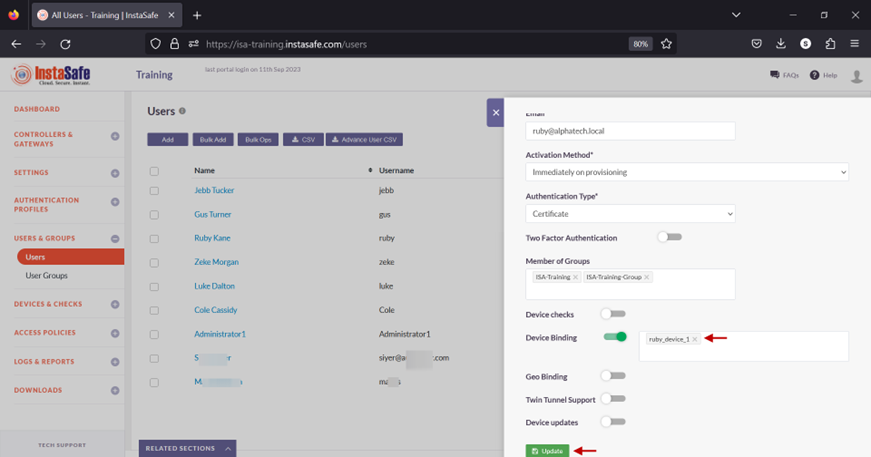

- A message at the bottom, User has been updated, indicates the configuration has been updated. Click on the “X” button to close this window. 

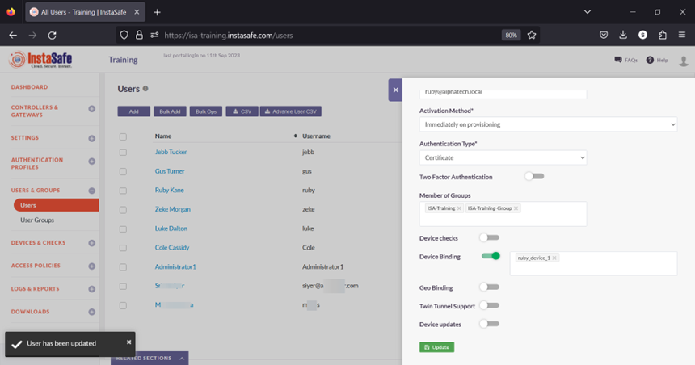

- Next, we will test Device Binding by connecting the user Ruby Kane from a different device than the device the user is bound to. 

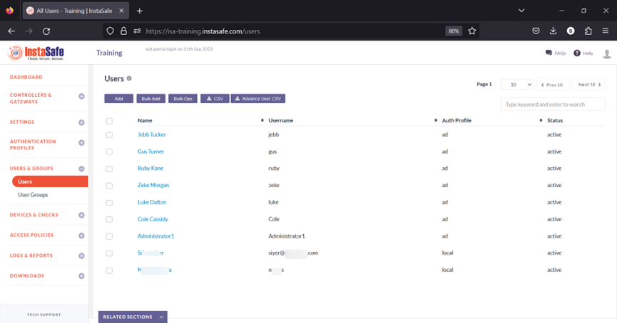

In the event you are unable to configure Device Binding by following these steps, please contact your organization's IT Team

If you are an administrator of the organization's ISA Account and need assistance, contact InstaSafe Support at [support@instasafe.com](support@instasafe.com).

## **Configure Device Binding Manual**

One method of Device Registration occurs when Instasafe Secure Access (ISA) automatically captures certain device identification details when an ISA User Agent connects to the ISA Controller.  

When a user's device information is auto-captured, the default status of the device is pending approval. Until approved or activated by the administrator, users with Device Binding enabled in their user group will be unable to connect using the ISA User Agent from the device. The ISA web portal administrator can manually activate, suspend, or delete the device.

However, this task can be daunting in the case of a large number of devices requiring approval or other status changes.  The Bulk Ops option on the Devices page automates this process by changing the statuses of a large number of devices at once. For more information on Bulk Ops, refer to the KB article Performing Bulk Operation on Device List.

Another method is to register devices manually.  Manual device registration is only required rarely.  Manual device registration requires the administrator to obtain the following information from the client OS:

1. MAC Address of the physical network adapter
2. Operating System Name
3. BIOS Serial Number
4. Universally Unique Identifier (UUID)

Using these parameters, it is possible to enforce Device Binding on users. Device Binding will ensure that the users are allowed to make connections only from those devices registered in the ISA web console.  This will eliminate attacks due to stolen or shared passwords. A user can be bound to multiple devices.

**Manual Device Registration**

1.On the Windows client, open Windows PowerShell and enter the following command:

a. Get-netadapter
    
b. systeminfo | findstr /B /C:"OS Name" /C:"OS Version"

c. wmic bios get serialnumber
    
d. wmic path win32_computersystemproduct get uuid

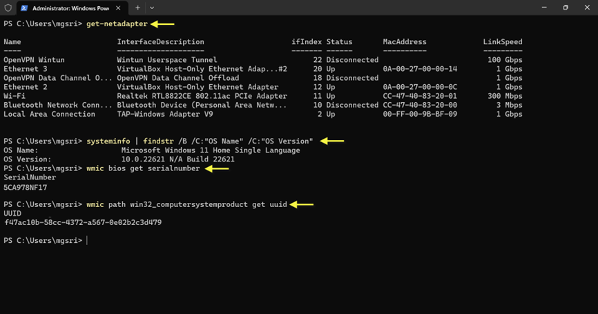

2.Log into the ISA web console using admin credentials

3.Navigate to the DEVICES & CHECKS > DEVICES page. 

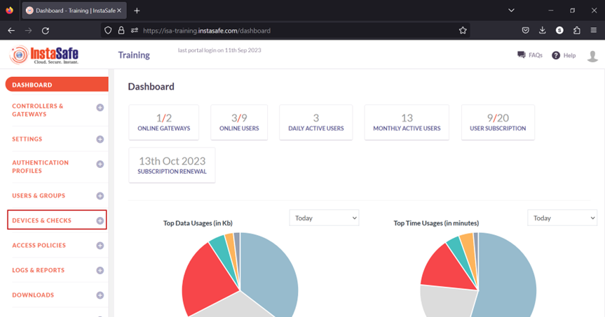

4.Click Add the button.

5.On the Add Device window, enter the following information:

a. Name: Enter a name for this device. The name must not have spaces.  Hyphens or underscores are allowed.

b. OS: Select the OS name obtained from the command executed in PowerShell.
    
c. MAC Address: Enter the MAC address of the physical network adapter that connects to the ISA Controller using the information obtained from the command executed in PowerShell.
    
d. Serial Number: Enter the BIOS serial number obtained from the command executed in PowerShell.

e. UUID: Enter the UUID obtained from the command executed in PowerShell.
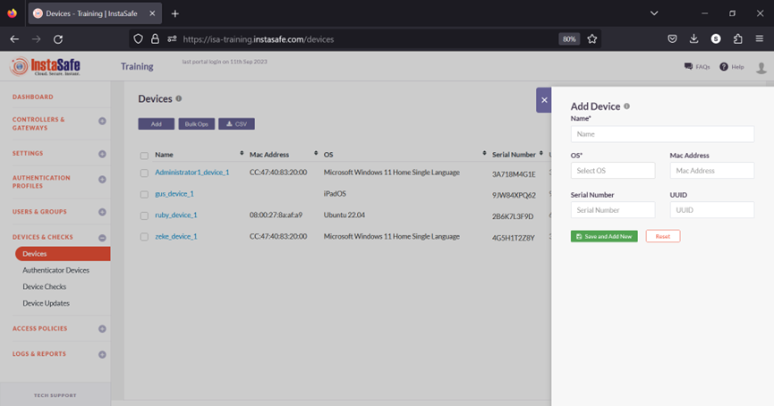

6.Click Save and Add New.

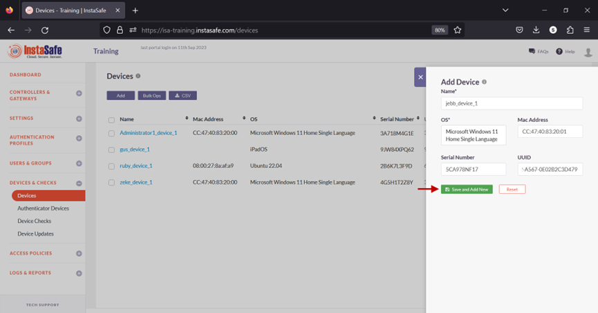

7.The new device will be listed on the Devices page. The device is automatically activated and, under status, will be shown as enabled.

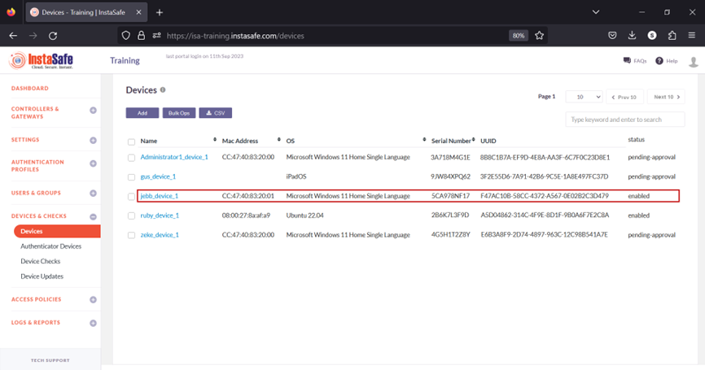

8.Navigate to the USERS & GROUPS > Users page.

9.On this page, click on the name of the user that requires binding. In this example, it is Jebb Tucker.

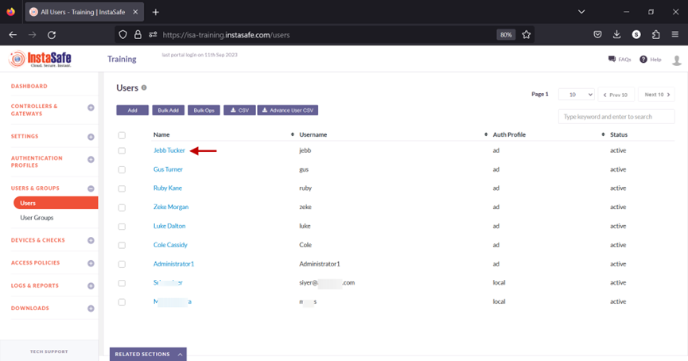

10.In the edit user window, click on Edit and scroll down the window.

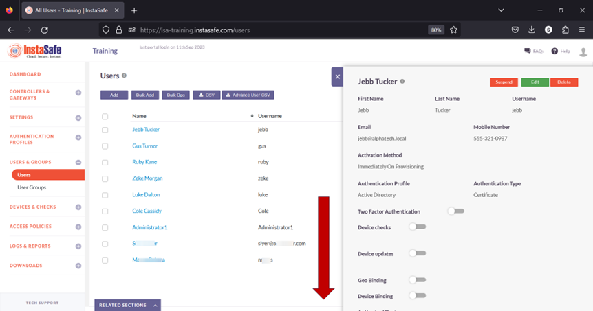

11.Toggle the Device Binding button to enable it. 

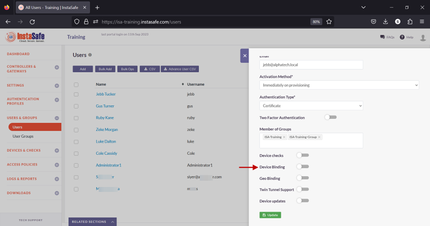

12.Click inside the Select devices box to list the device names. 

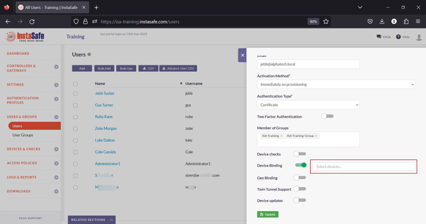

13.Select the device name for the user. In this example, _jebb_device_1_. 

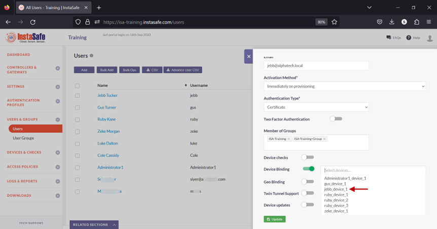

14.Click on Update at the bottom to save this configuration. 

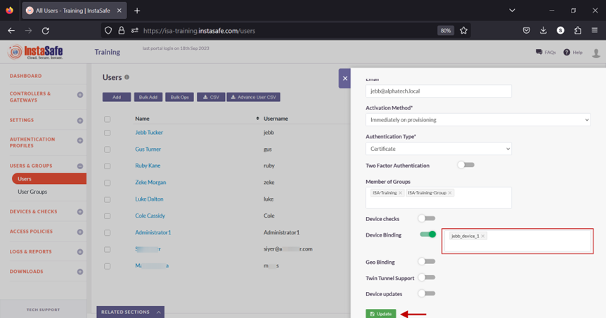

15.A message at the bottom, User has been updated, indicates the configuration has been updated. Click on the “X” button to close this window. 

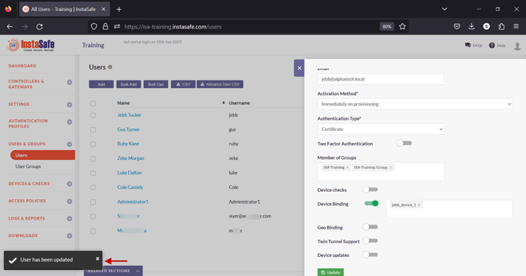

16.Next, we will test Device Binding by connecting the user Jebb Tucker from a different device than the device the user is bound to. 

In the event you are unable to configure Device Binding by following these steps, please contact your organization's IT Team.

If you are an administrator of the organization's ISA Account and need assistance, contact InstaSafe Support at  [support@instasafe.com](support@instasafe.com).

## **Manage Bulk Operation on Device List**

When a user's device information is captured, the default status of the device is pending approval. Until approved or activated by the administrator, users with Device Binding enabled in their user group will be unable to connect using the ISA User Agent from the device. The ISA web portal administrator can manually activate, suspend, or delete the device.

However, this task can be daunting in the case of a large number of devices requiring approval or other status changes. 

The Bulk Ops option on the Devices page automates this process by changing the statuses of a large number of devices at once.

This article describes the step-by-step process of this operation.

- Log into the ISA web portal with administrator credentials
- Navigate to the DEVICES & CHECKS > Devices page.
- Click Bulk Ops at the top.

- Click the Select the bulk operation drop-down. Listed in this field are the following operations:

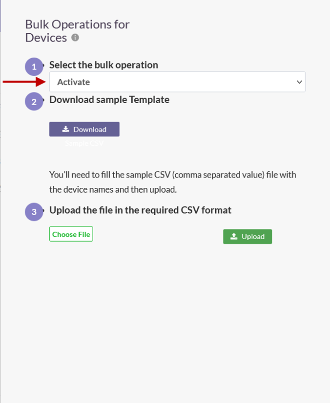

a. Activate – Activate the device and set the device status to _enabled_.

b. Suspend – Suspend the device and set the device status to _suspend_. Under this status, if Device Binding is enabled for the user, or the user group, remote users will not able to connect using the ISA User Agent.

c. Delete – Delete the device from the Devices page. When a user attempts to connect, the device information of the user will be auto-captured and displayed on the Devices page with status set to _pending-approval_.

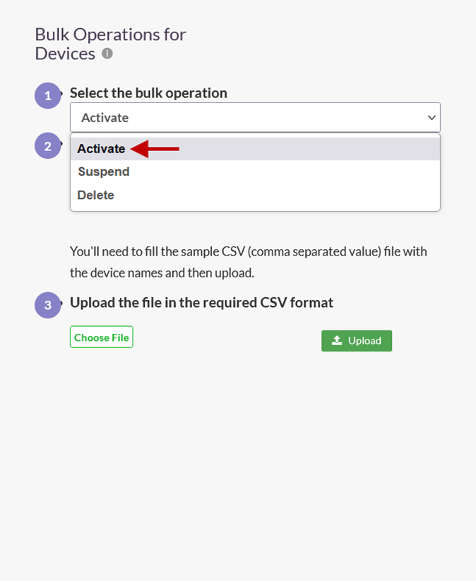

- After selecting the bulk operation, click the Download button to download the template file for device names. 

- Open the template in a spreadsheet application. By default, the file is empty with a column titled Devicename.

- Enter the names of the devices under the Devicename column and save it. 

- Back on the Bulk Operations for Devices window, click Choose File and select the saved template file.

- Click Upload.        

- On the Uploaded Devices window, click Submit.

- On the Devices page, device statuses are updated according to the bulk operation. If the operation is set to delete devices from the template file, the device will be removed from this page. 

In the event you are unable to perform Bulk Ops by following these steps, contact your organization's IT Team.

If you are an administrator of the organization's ISA account and need assistance, contact InstaSafe Support.

## **Geofence Configuration**

- Login to the InstaSafe ISA Portal with admin credentials

- Navigate to **Devices and Checks** -> **Geofence**

- Click on the ‘Add’ button and enter the Geofence details

- After entering the location, the latitude and longitude will update automatically. If needed, the admin can manually update the latitude and longitude.

- Assign the geofence to the user profile.

When geofencing is enabled for a user, they are allowed to log in or access the application only within the geolocation radius configured by the admin. If the end user is outside the configured geofence radius, they will not be able to log in to InstaSafe and will receive an error message stating, '**Your geolocation is outside the configured geofence**.'

When the end user returns to the configured geofence range, they should be able to log in to the agent and end-user console without any errors.

## **Application Blocking**

The **App-Blocking** feature empowers administrators to control system applications on end-user devices. Using this functionality, administrators can restrict one or more applications from running on end-user systems when InstaSafe is connected.

**Key Highlights:**

- Flexible Control: Administrators can enable app-blocking at both the User and Group levels.
- Enhanced Security: Prevents unauthorized or non-compliant applications from running during active connections, ensuring secure and policy-driven usage.

**Enabling the App-Blocking Feature:**

To activate this feature, administrators need to follow the steps below:

1.Go to the Device & Checks module in the InstaSafe Admin Console.

2.Select the Blocked Apps sub-module.

3.Click the Add button to create a new application profile.

4.Enter a name for the application profile. Select Microsoft Windows for Windows-based applications. Specify the application name along with its extension (e.g., mspaint.exe).

5.Click Save and Add New to save the profile.

6.The newly created profile will appear in the Blocked Apps list.

**Assigning the Blocked Application:**

The blocked application can be assigned at either the User OR Group levels.

_User Level_

1.Navigate to the User and Group module in the InstaSafe Admin Console.

2.Select the User section and search for the user to whom the app-blocking feature should be applied.

3.Click on the user to enable Edit Mode.

4.Enable the following toggles:

- Device DLP and select the **Enable Block App Feature - Restart required**.

- Block Apps and select the previously created blocked application to prevent it from running on the user's system.

5.Click Update to apply the changes.

_Group Level_

1.Navigate to the User and Group module in the InstaSafe Admin Console.

2.Select the Group section and search for the group to which the app-blocking feature should be applied.

3.Click on the group to enable Edit Mode.

4.Enable the following toggles:

- Device DLP and select the **Enable Block App Feature - Restart required**.

- Block Apps and select the previously created blocked application to prevent it from running on the user's system.

5.Click Update to apply the changes.

**Disabling the App-Blocking Feature:**

_User Level_

1.Navigate to the User section and search for the user for whom app-blocking should be disabled.

2.Click on the user and enable Edit Mode.

3.Perform the following actions:

- Remove the **Enable Block App Feature - Restart required** from the Device DLP.

- Select **Disable Block App Feature - Restart required**. Also disable the **Block Apps** toggle

4.Click Update to save the changes.

_Group Level_

1.Navigate to the Group section and search for the group for which app-blocking should be disabled.

2.Click on the group and enable Edit Mode.

3.Perform the following actions:

- Remove the **Enable Block App Feature - Restart required** from the Device DLP.

- Select **Disable Block App Feature - Restart required**. Also disable the **Block Apps** toggle

4.Click Update to save the changes.

**Limitations of the App-Blocking Feature**

1. It is recommended to make changes to the app-blocking configuration during non-working hours or when the user is not connected to the InstaSafe Agent.
2. The admin can enable either the "Enable App Block" feature or the "Disable App Block" feature for a particular user at a time.
3. Enabling both simultaneously for the same user may cause the app-blocking feature to malfunction.
4. Enabling or disabling the app-blocking feature for a user requires a one-time system restart for the changes to take effect.
5. If an application is blocked through the InstaSafe App-Blocking feature, the user will not be able to use the application until the InstaSafe Agent is manually disconnected. The application will remain blocked as long as the agent is active, even if changes are made.

## **Configuring Device Updates**

The device update feature enables the ISA web portal administrator to remotely install software updates, upgrades, or hotfixes for individual users or user groups. Within the **DEVICES & CHECKS** menu on the ISA web portal, administrators can create a device update profile on the **Device Updates** page. This profile includes the hotfix or software upgrade file, along with parameters specifying how to apply the updates. These updates are generally delivered in MSI or EXE file formats and typically consist of bug fixes or security enhancements aimed at improving the overall functionality and security of the ISA User Agents.

**Create Device Updates**

- Login to the ISA web console using administrator credentials and navigate to the **Device Updates** page under the **DEVICES & CHECKS** menu.

- Click the **Add** button at the top.

- On the **Add Update** window, under **Name**, enter a name for the update profile. **The name must be unique and must not be the same as another device update profile.** Characters A-Z, a-z, 0-9 are allowed in this field.  The maximum number of characters allowed is 50. All fields with an asterisk require to be filled-in.

- Click Upload file.

- Select the MSI or EXE file from the local drive. **The filename must be unique and must not be the same as the name of a file in another device update profile.**

- In the **Argument** field, enter the argument to be passed to the executable file for command land installation. If the update file format has EXE extension, the typical argument is “/S”. If the update file format has MSI extension, no argument is required, instead enter “0”.  

- Click the drop-down under **Install Schedule**.

- There are two options, **Immediate** and **After-Reboot**. Selecting **Immediate** will begin the installation process at once. The first cron job will create a temp folder with the executable file in it. The second cron job will execute the file. Selecting **After-Reboot** will install the update after the device is rebooted. The first cron job will create a temp folder with the executable file in it. The second cron job will execute the file after the device is rebooted.

- Click the drop-down under the **Post Validation Check**. Post validation check will verify whether a registry entry or file is present at a given location in the user’s device. 

- There are two options here, **Registry Key present** and **File present**. If **Registry Key present** is selected, enter the registry subkey or path to verify. For example, _HKLM\Software\WOW6432Node\InstaSafe\Hotfix31_. If the **File present** option is selected, enter the path of the file in the format C:\Program Files (x86)\InstaSafe\bin.

- Click the drop-down under **State**.

- Select either **Enabled** or **Disabled**. **Enabled** will install the update, and **Disabled** will not install the update. 

- Click **Save and Add new**.

- The device update profile is listed on the page. 

**Assign Device Update to User Group**

- Navigate to the **User Groups** page under the **USERS & GROUPS** menu.

- Click the name of the user group you want to assign the device update profile.

- In the **Group details** window, click **Edit**.

- Enable the **Device updates** toggle button.

- Click the **Select device updates** drop-down.

- Select the update profile. 

- Click **Update** to save.

**Assign Device Update to User** 

- Navigate to the **Users** page under the **USERS & GROUPS** menu.

- Click the name of the user you want to assign the device update profile.

- In the **User details** window, click **Edit**.

- Scroll down the window.

- Enable the **Device updates** toggle button.

- Click the **Select device updates** and select the update profile.

- Click **Update** to save.

**Edit Device Update**

- On the **Device Updates** page, click the name of the update profile you want to edit.

- In the window, click the **Edit** button.

- In the **Edit device update** window, make the necessary edits and click on **Save**.

**Delete Device Update**

- On the **Device Updates** page, enable the check box alongside the update profile you want to delete.

- Click the **Delete** button at the top.

- On the pop-up window, click **Yes, Delete it!**.

- On the bottom left of the page, the message **Successfully deleted device updates** is displayed. 

**Navigating the Device Updates list**

The **Device Updates** page allows easy pagination for viewing a large number of device update profiles. You can view the profiles by using the navigation control bar at the top right of the page.

Click the drop-down box to select the number of profiles to be displayed on the page. By default, it is set to display 10 profiles. You can change it to display either 30 or 50 profiles. 

Click the **Next** button to view the next page of device update profiles. Click the **Prev** button to view the previous page.

You can search device update profiles by name by entering it in the search box.

**Conclusion**

The device update feature allows the ISA web portal administrators to remotely install software updates, upgrades, or hotfixes for individual users or user groups.