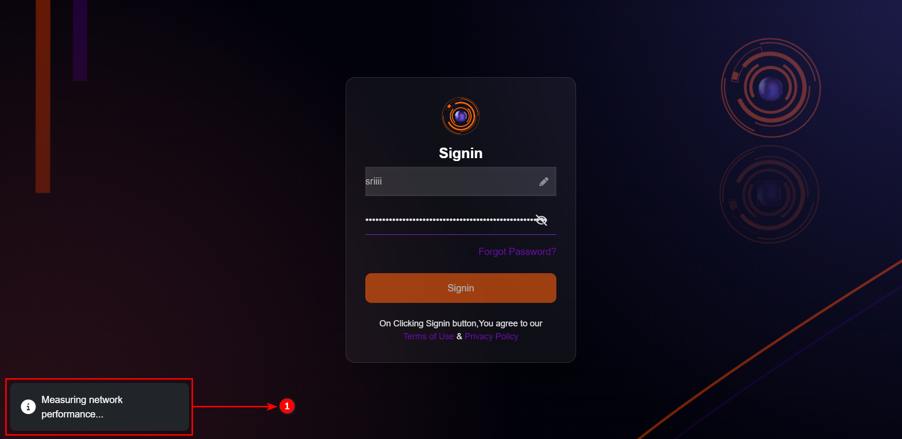
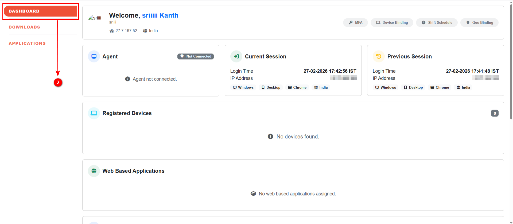
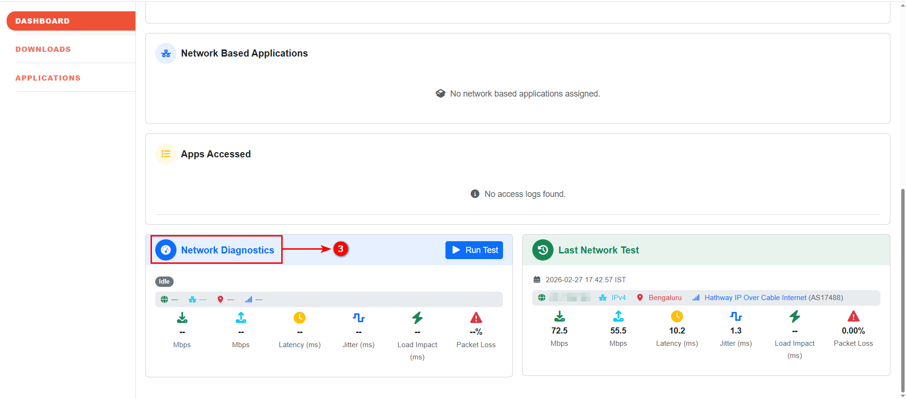
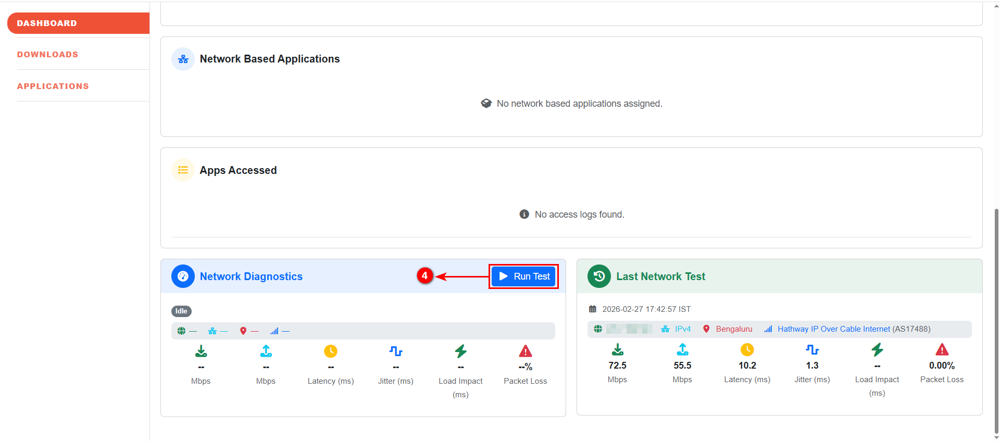
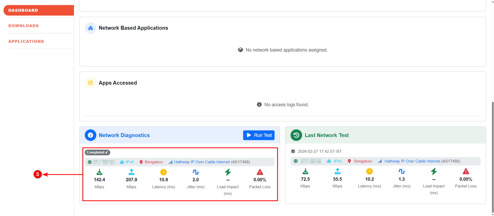
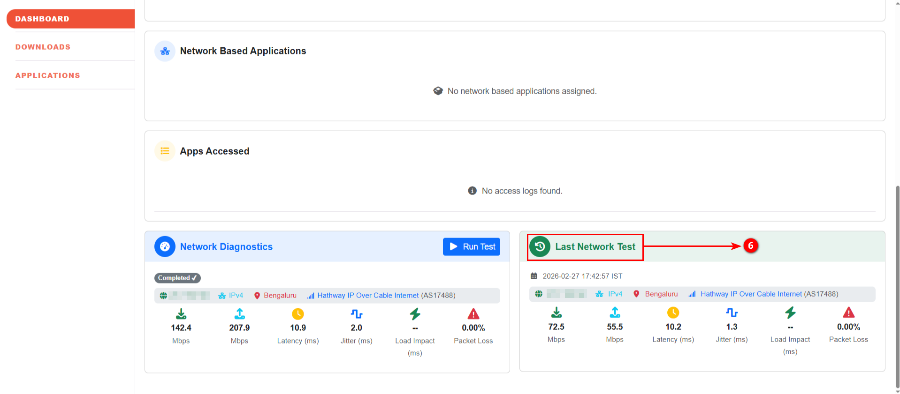

# Network Diagnostics

Network Diagnostics is a built-in troubleshooting feature available within the InstaSafe User Portal (Console). It enables users to run real-time network performance tests directly from the dashboard to identify connectivity or performance issues affecting secure application access.

The feature provides visibility into download/upload speed, latency, jitter, load impact, and packet loss. Administrators can monitor and review user test results under **Network Test Report**. InstaSafe also supports GUI-based packet capture with export capability in standard **PCAP format**, enabling deeper analysis using external tools when required.

## Key Capabilities

- Real-time network performance testing from the User Portal dashboard  
- Metrics: Upload (Mbps), Download (Mbps), Latency (ms), Jitter (ms), Packet Loss (%)  
- Historical visibility of previously executed network tests  
- Admin-level monitoring via **Logs & Reports → Network Test Report**  
- CSV export of network test reports  
- GUI-based packet capture  
- Export captured traffic in **standard PCAP format**

## Running Network Test (User)

1. Log in to the i365 User Portal (Console); the “Measuring Network Performance” pop-up appears after successful login.

    

2. Navigate to the **Dashboard**.  

    

3. Locate the **Network Diagnostics** widget.  

    

4. Click **Run Test** to initiate the network performance test. 

    

5. Review the displayed metrics.

    

6. You can also view the Previous Network Test Result under "Last Network Test".

    

**Note:** Network test result reports can be viewed and exported only by Administrators from the Admin Console. This functionality is not available to end users.

