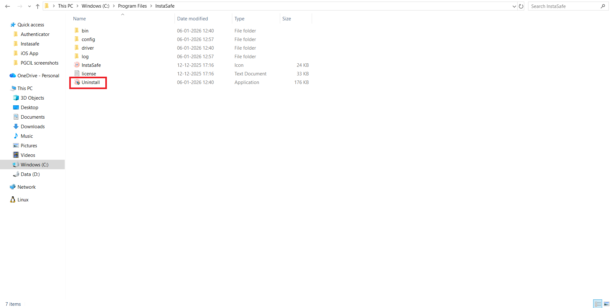
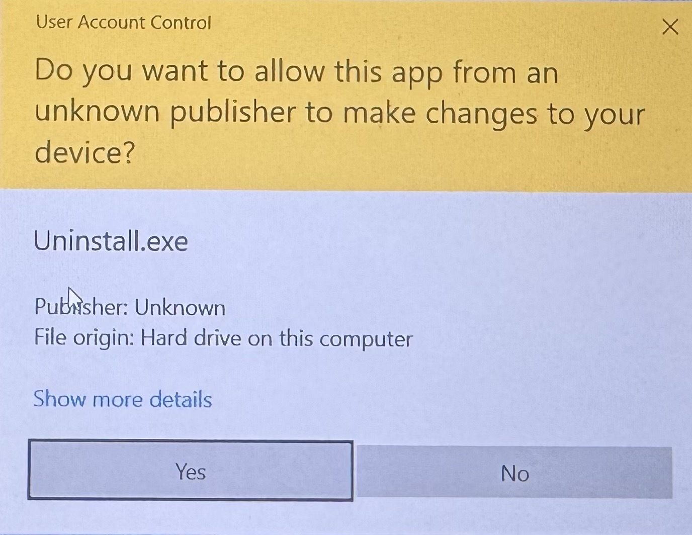
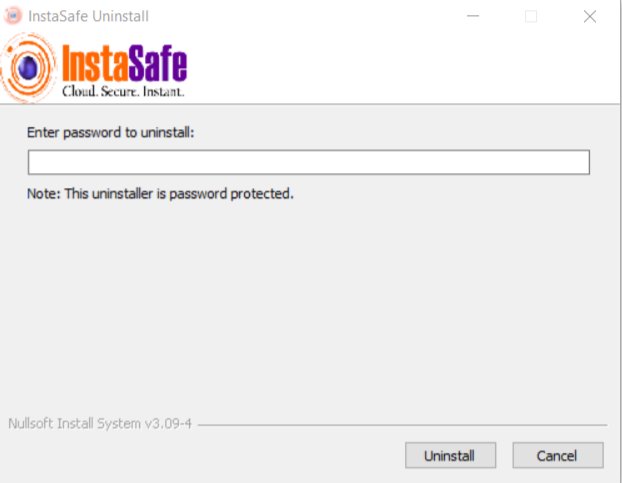
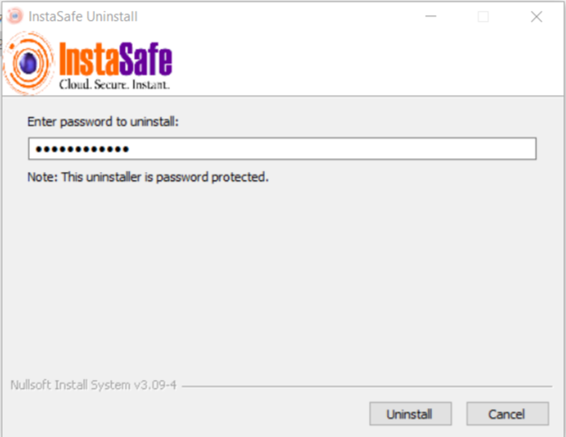

# Agent Un-installation

For security reasons, agent uninstallation is password-protected and can only be performed using the **uninstallation password provided by the organization’s administrator**. This ensures that users cannot bypass device compliance, device binding, or security controls.

This article provides step-by-step instructions to safely uninstall the InstaSafe Windows Agent from a client system.

## Uninstalling the Windows Agent

1. Open **This PC**.

2. Navigate to **Program Files**.

3. Open the **InstaSafe** folder.

4. Double-click **Uninstall.exe**.

    

5. When the **User Account Control (UAC)** prompt appears, click **Yes** to allow the application to make changes.

    

6. The **InstaSafe Uninstall** window will open.

7. Enter the **uninstallation password** when prompted (provided by your Administrator).

    

8. Click **Uninstall**.

    

The InstaSafe Windows Agent will be successfully uninstalled from the system.