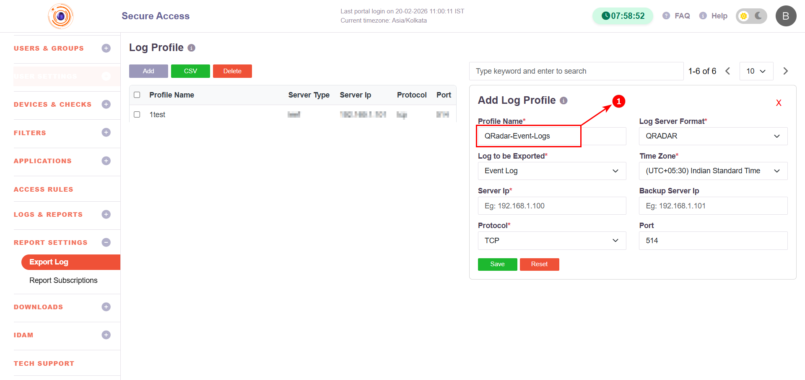
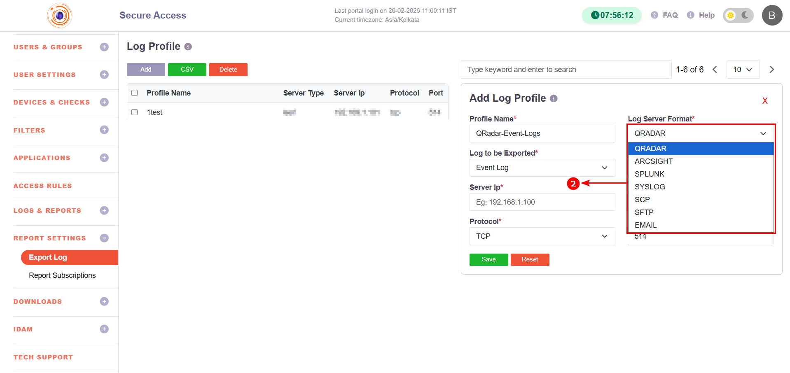
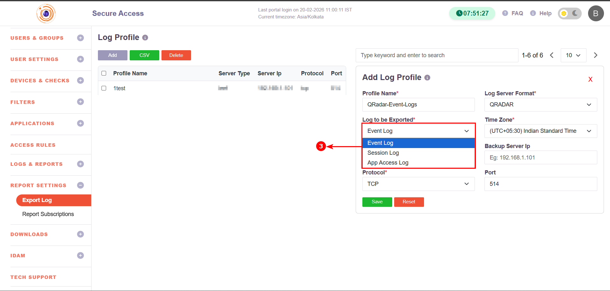
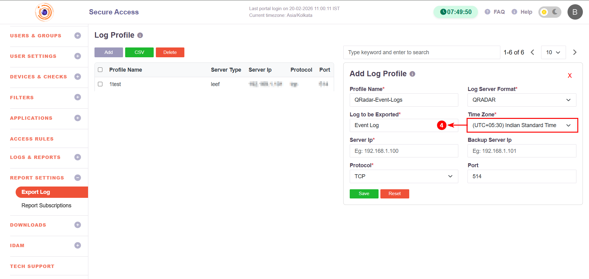
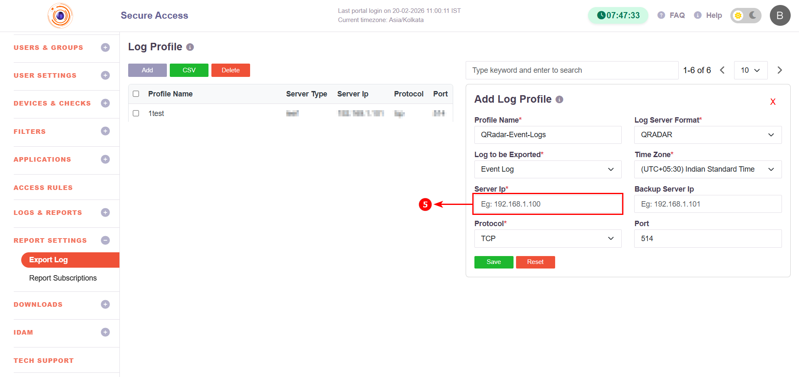
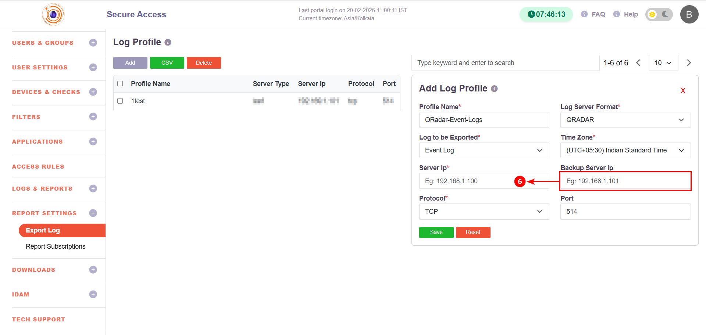
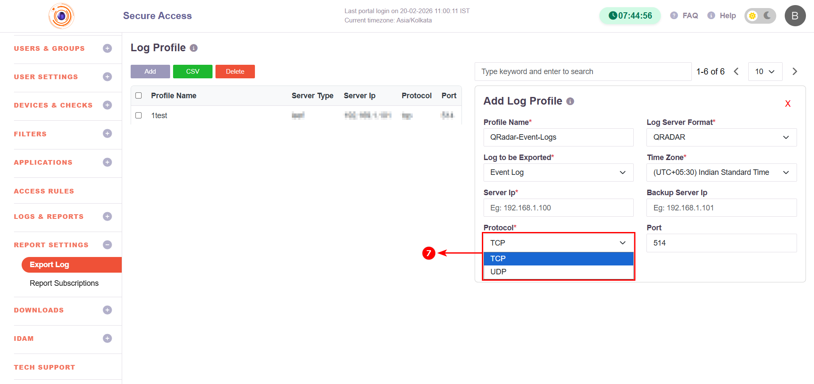
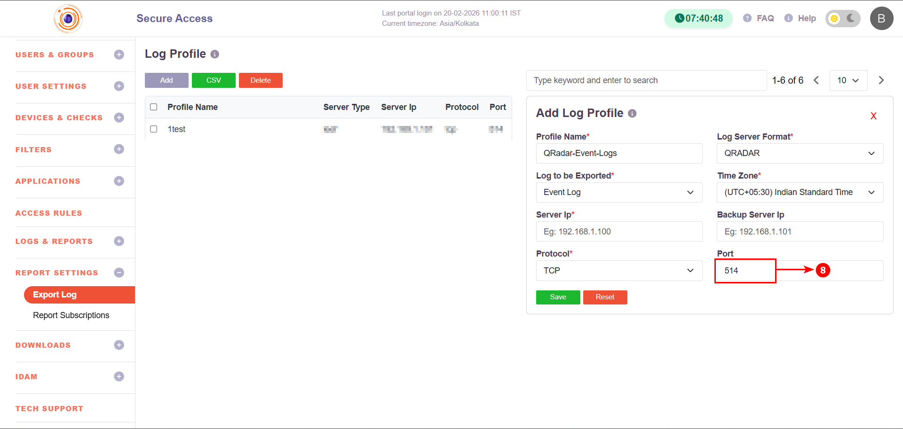

# Export Logs

The **Log Export** feature allows administrators to forward InstaSafe logs to external log servers or SIEM platforms for monitoring, auditing, and compliance purposes.

Supported destinations include SIEM platforms and standard log transfer mechanisms such as:

- QRADAR
- ArcSight
- Splunk
- Syslog
- SCP
- SFTP
- Email

Log export is configured using a **Log Profile**.

## Accessing Log Export Configuration

1. Login to the InstaSafe Web Console.
2. Navigate to:
   
- **Report Settings → Export Logs**

3. Click **Add** to create a new log profile.

## Configuration Steps

## Step 1: Basic Configuration

Fill in the required fields in the **Add Log Profile** section:

### 1. Profile Name
Provide a unique name for the log export profile.

- Example:  
`QRadar-Event-Logs`

     
    

### 2. Log Server Format

Select the destination log format:

- QRADAR
- ARCSIGHT
- SPLUNK
- SYSLOG
- SCP
- SFTP
- EMAIL

    

This determines how the logs are formatted and transmitted.

### 3. Log to be Exported

Select the log category:

- **Event Log** – System and administrative activities  
- **Session Log** – User session start/stop information  
- **App Access Log** – Application-level access details  

    

### 4. Time Zone

Select the time zone for exported logs.

- Example:  
`(UTC+05:30) Indian Standard Time`

    

## Step 2: Destination Server Configuration

### 5. Server IP

Enter the destination log server IP address.

- Example:
`192.168.1.100`

    

### 6. Backup Server IP (Optional)

Specify a secondary server IP to ensure log delivery if the primary server is unavailable.

- Example:
`192.168.1.101`

    

### 7. Protocol

Select the communication protocol:

- TCP (recommended for reliability)
- UDP (if supported by SIEM)

    

### 8. Port

Specify the destination port number.

- Default for Syslog:
`514`

    

Port may vary depending on SIEM configuration.

## Step 3: Save Configuration

1. Click **Save** to create the log profile.
2. The configured profile will be listed under the Log Profile table.
3. Use **Delete** to remove a profile if required.
4. Use **CSV** to export log profile entries (if needed).

## Log Server Format Reference

| Format    | Typical Use Case | Default Port | Protocol |
|-----------|------------------|--------------|----------|
| QRADAR    | IBM QRadar SIEM integration | 514 | TCP/UDP |
| ARCSIGHT  | Micro Focus ArcSight SIEM | 514 | TCP/UDP |
| SPLUNK    | Splunk log ingestion | 514 / Custom | TCP |
| SYSLOG    | Standard Syslog server | 514 | TCP/UDP |
| SCP       | Secure file-based log transfer | 22 | SSH |
| SFTP      | Secure file transfer | 22 | SSH |
| EMAIL     | Log export via email notification | SMTP Port | TCP |

## Log Types Reference

| Log Type        | Description |
|-----------------|-------------|
| Event Log       | Administrative events, configuration changes, system actions |
| Session Log     | User login/logout, session duration details |
| App Access Log  | Application access attempts and activity |

# Summary

The Log Export feature enables centralized log monitoring by forwarding InstaSafe logs to external SIEM platforms or secure transfer destinations. By configuring a Log Profile, administrators can select the log type, format, protocol, and destination details to meet monitoring and compliance requirements.
