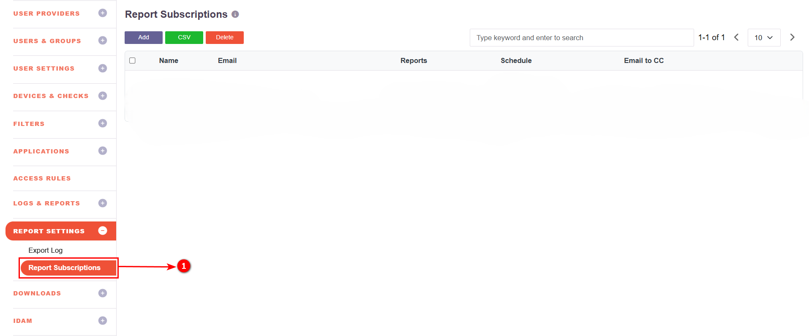
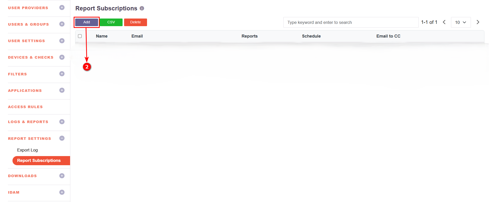
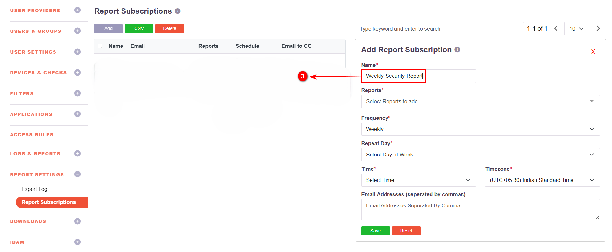
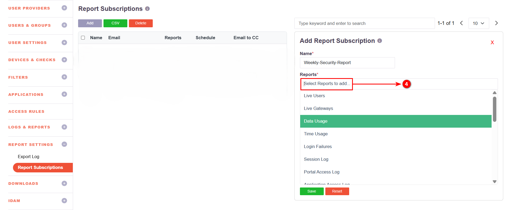
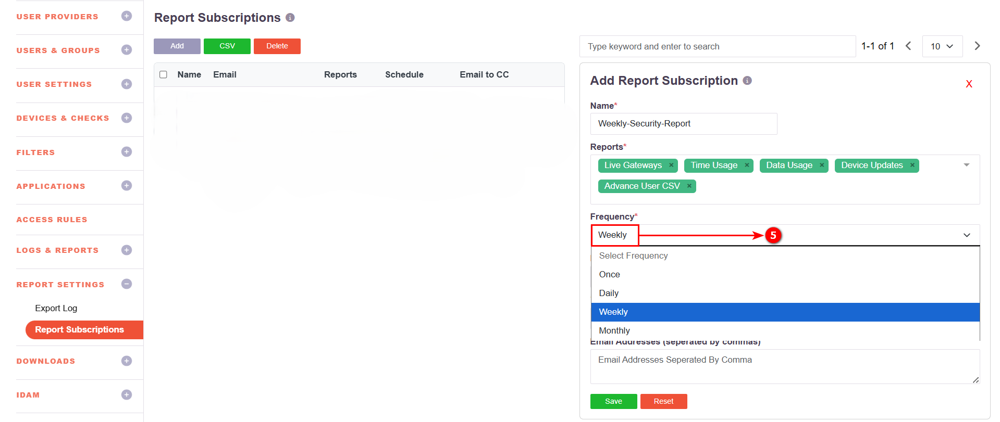
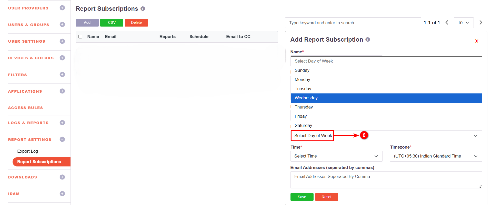
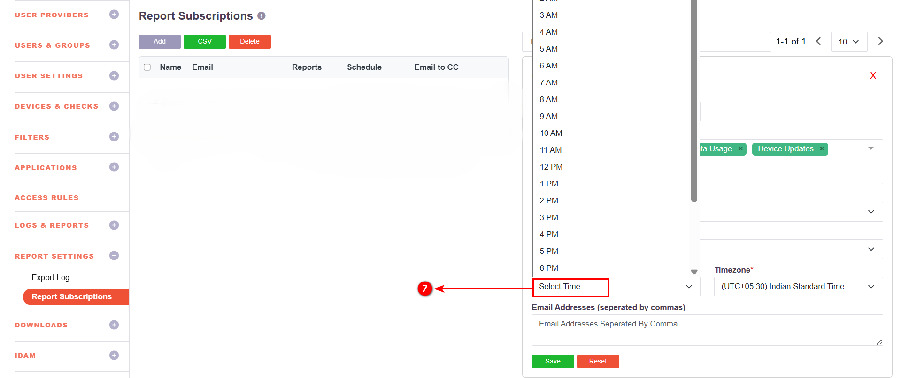
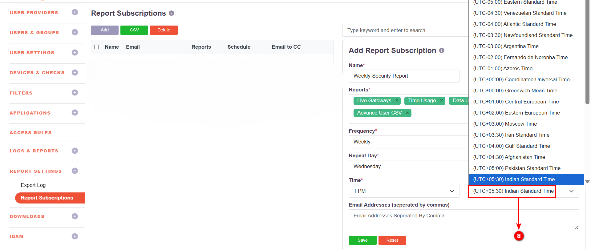
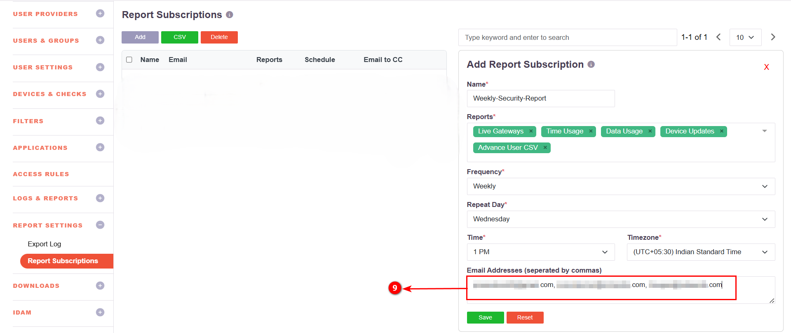
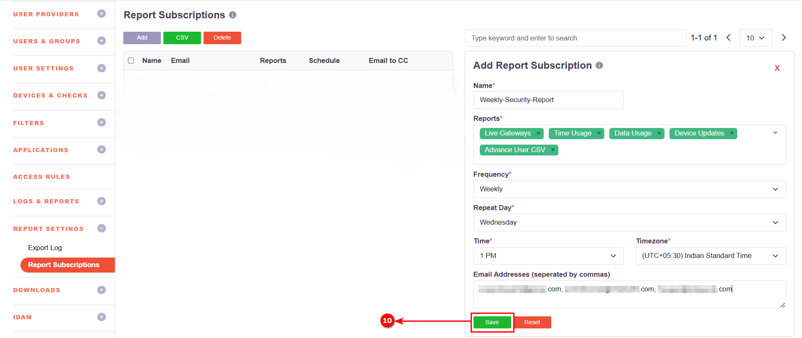

# Report Subscriptions

## Report Subscriptions

The **Report Subscriptions** feature allows administrators to automatically generate and email selected reports at scheduled intervals.  
It enables regular monitoring, compliance reporting, and operational visibility without manual effort.

---

## Step-by-Step Configuration

**Step 1:** Access Report Subscriptions

- Log in to the portal with Admin credentials and navigate to   **Report Settings → Report Subscriptions**

    

**Step 2:** Add New Subscription

- Click **Add**

    

**Step 3:**  Provide Subscription Name

- Enter a unique name for the subscription.

    

**Step 4:**  Select Reports

- Select one or more reports to include.

**Available report categories:**

- Live Users / Live Gateways  
- Data Usage / Time Usage  
- Login Failures / Session Log / Event Log  
- Application Access Log / Portal Access Log  
- User & Group Reports  
- Device & Controller Reports  
- Access Policies & Authentication Reports

    

> **Note:** Multiple reports can be selected.

**Step 5:**  Choose Frequency

- Choose how often the report should be generated:  
**Once / Daily / Weekly / Monthly**

    

**Step 6:**  Configure Repeat Day

- If **Weekly** or **Monthly** is selected, specify the **Repeat Day**.

    

**Step 7:**  Set Report Time

- Select the time for report generation.  
_Time Range: 12 AM to 11 PM (1-hour intervals)_

    

**Step 8:**  Select Timezone

- Select the applicable timezone.

    

**Step 9:**  Add Email Recipients

- Enter recipient email addresses separated by commas.

    

**Step 10:**  Save Subscription

- Click **Save** to activate the report schedule.

    

---

The subscription will be listed in the **Report Subscriptions** table.  
Use **Delete** to remove a subscription or **CSV** to export the list.