# SCIM Export

SCIM (System for Cross-domain Identity Management) Export enables automated provisioning and de-provisioning of users and groups from InstaSafe to third-party applications. InstaSafe supports SCIM 2.0-based provisioning, allowing secure synchronization of user lifecycle events (create, update, and delete) to integrated SaaS and enterprise applications through standardized SCIM APIs.

This ensures identity consistency across systems, reduces manual administrative effort, and enables centralized lifecycle management directly from the InstaSafe platform.

## Configuring SCIM Export (Databricks)

1. From the left navigation menu, go to **IDAM** and select **SCIM Export**.
    
    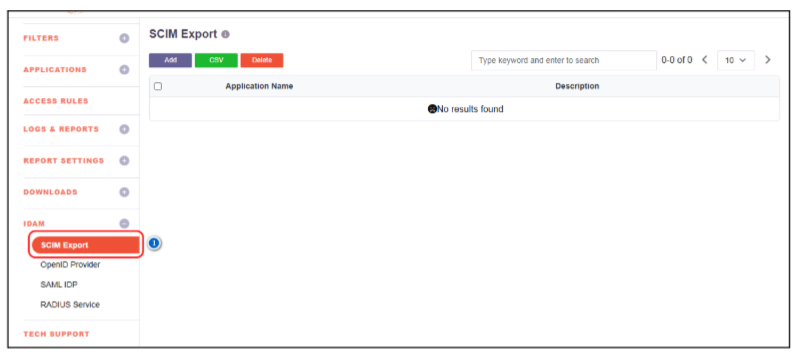

2. Click **Add**, enter the **Application Name**, provide a description for the application, and click **Save**.

    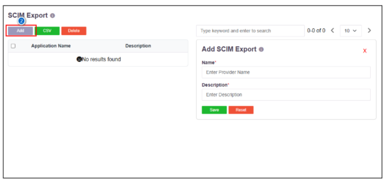

3. Click the created **SCIM Export profile**.

    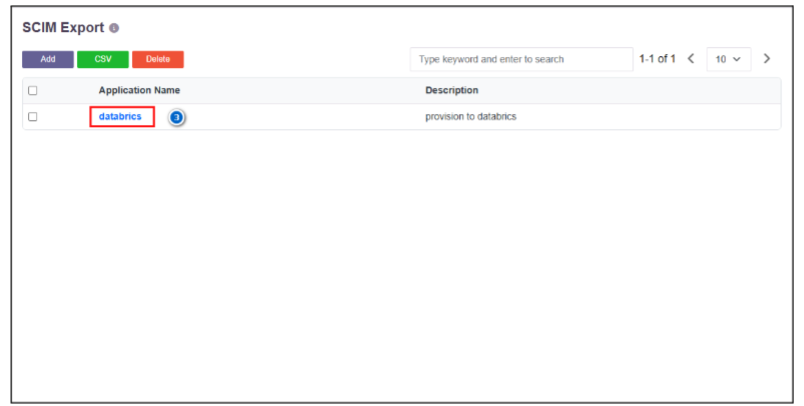

4. Enter the **Tenant URL** and **Secret Token**.  
   (The Tenant URL and Secret Token can be obtained from the Databricks Admin Dashboard under the **Provisioning** section.)

    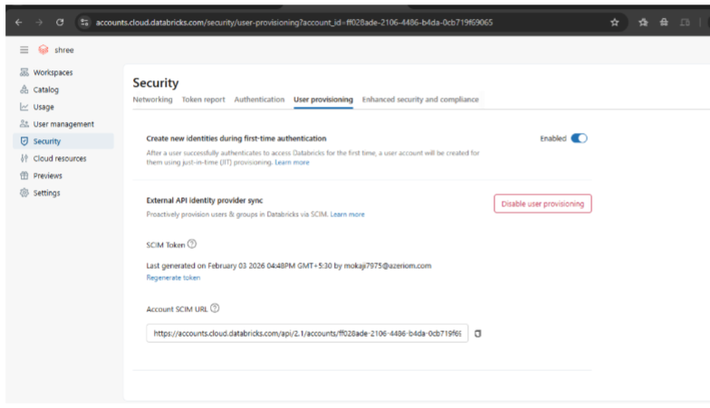
    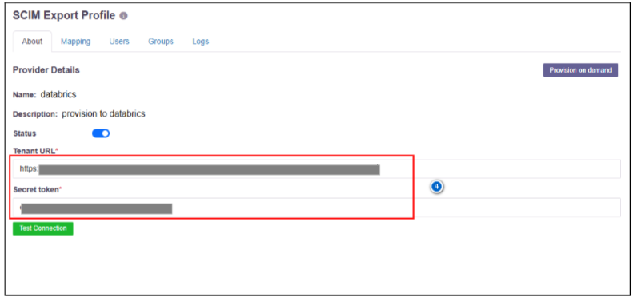

5. Click **Test Connection**.  
   (If the connection fails, verify that the Tenant URL and Secret Token are correct.)

    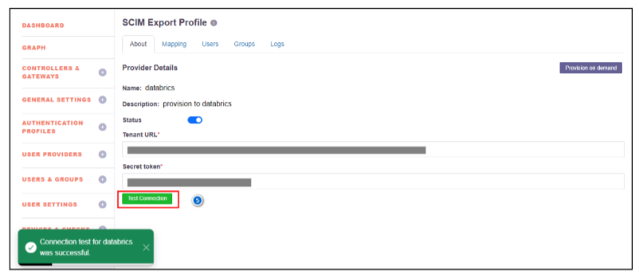

6. Navigate to **Mapping**, select **User Mapping**, map the local attributes to the corresponding **SCIM attributes**, and click **Save**.

    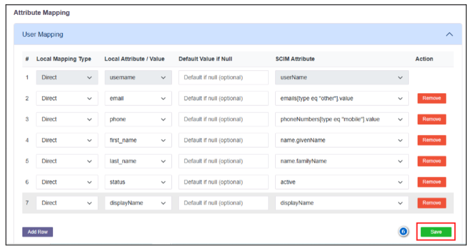

7. Select **Group Mapping** and add the required group attributes.

8. Click **Save**.

    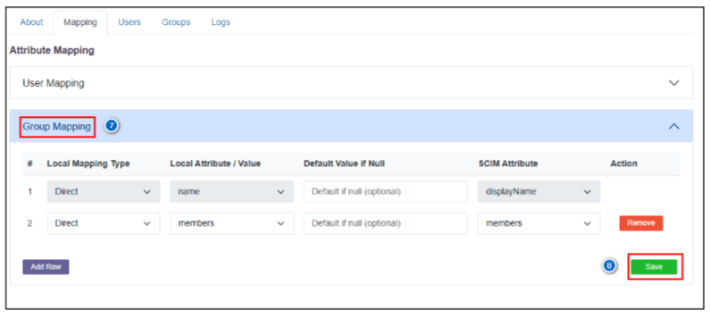

9. Navigate to **Groups** within the SCIM Export profile.

10. Assign the required user group(s) for syncing users.

11. Click **Sync**.

12. A notification will be displayed indicating that the **user and group sync is queued**.

    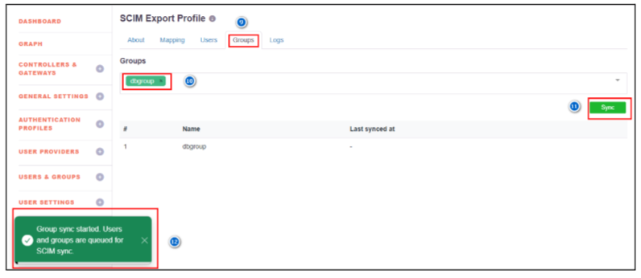

13. Navigate to **About**.

14. Click **Provision on Demand** (for the first-time synchronization; otherwise, SCIM sync will run based on the configured schedule).

15. A notification will be displayed indicating that the **SCIM sync has been initiated**.

    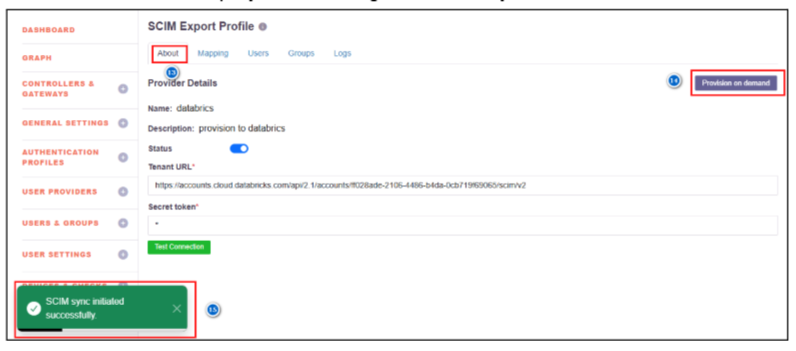

16. After a successful sync, navigate to **Logs**.  
    (If any issue occurs, verify the details in the logs.)

17. User creation, update, deletion, group creation logs, and any related errors will be displayed.

    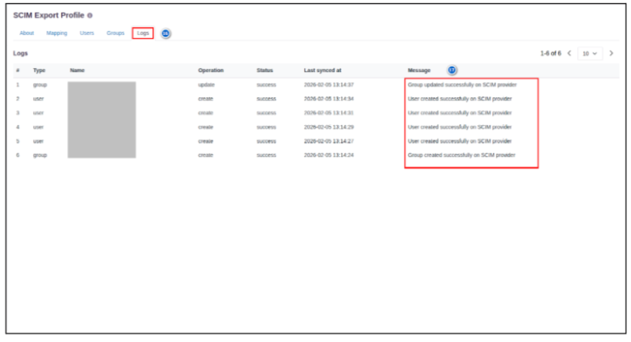

---

### Post-Configuration Verification

- Navigate to the configured **Databricks** application to verify the provisioned users and groups.
- In the SCIM-configured application, configure **SSO (SAML / OpenID Connect)** to enable authentication for the provisioned users.
