# **SCIM Import** 

# SCIM User Import from Okta to InstaSafe Application

## 1. Overview

This guide explains how to configure **SCIM User Import** from Okta to your application. After configuration, users and groups from Okta are automatically imported into your application.

**SCIM (System for Cross-domain Identity Management)** is an industry-standard protocol used for automated user provisioning and lifecycle management between an Identity Provider (Okta) and your application (Service Provider). Once configured, Okta becomes the authoritative source for user and group data in your application.

## 2. Benefits

- Automatic user and group import  
- Centralized identity management through Okta  
- Reduced manual user creation in your application  
- Automatic user updates and deprovisioning  
- Improved security and audit visibility  

SCIM User Import ensures that user information in your application remains synchronized with Okta.

## 3. When Should You Enable SCIM User Import?

Enable SCIM User Import if:

- You manage users primarily in Okta  
- You want automatic user provisioning in your application  
- You want to eliminate manual user management  
- You require centralized lifecycle management (joiner, mover, leaver process)  
- You need consistent user data across systems  

SCIM Import is recommended for organizations using Okta as their primary Identity Provider.

## 4. Prerequisites

Before configuring SCIM User Import from Okta to your application, ensure that you have:

- Administrator access to the Okta Admin Console  
- Administrator access to your application  
- SCIM Base URL of your application  
- SCIM Authentication Token (if required)  
- Required user and group attribute mappings  
- Network connectivity between Okta and your application  

Once these prerequisites are met, you can proceed with the SCIM configuration for seamless user synchronization.

# 5. Generate SCIM API Token in InstaSafe

## Step 1: Add New Application

- Log in to the Admin Console  
- Navigate to: **Applications → Applications**  
- Click **Create App Integration**

    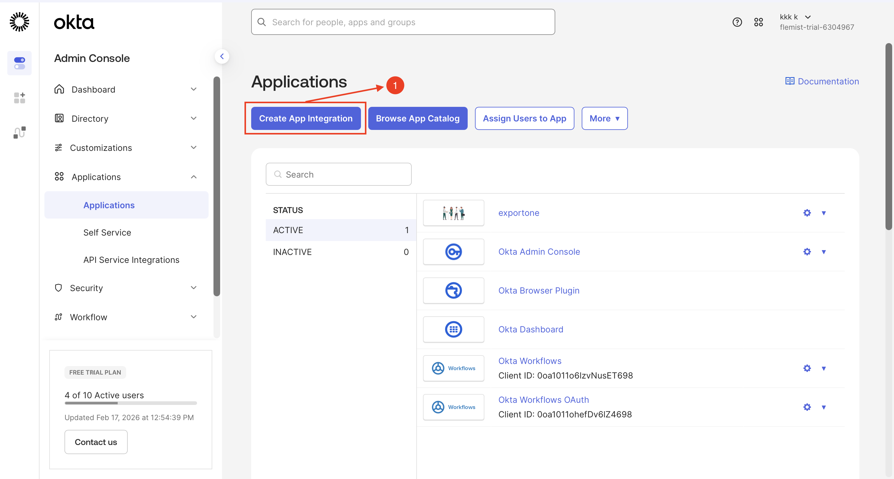

## Step 2: Selecting the Authentication Type

- Select the authentication type as **SAML 2.0**  
- Click **Next**

    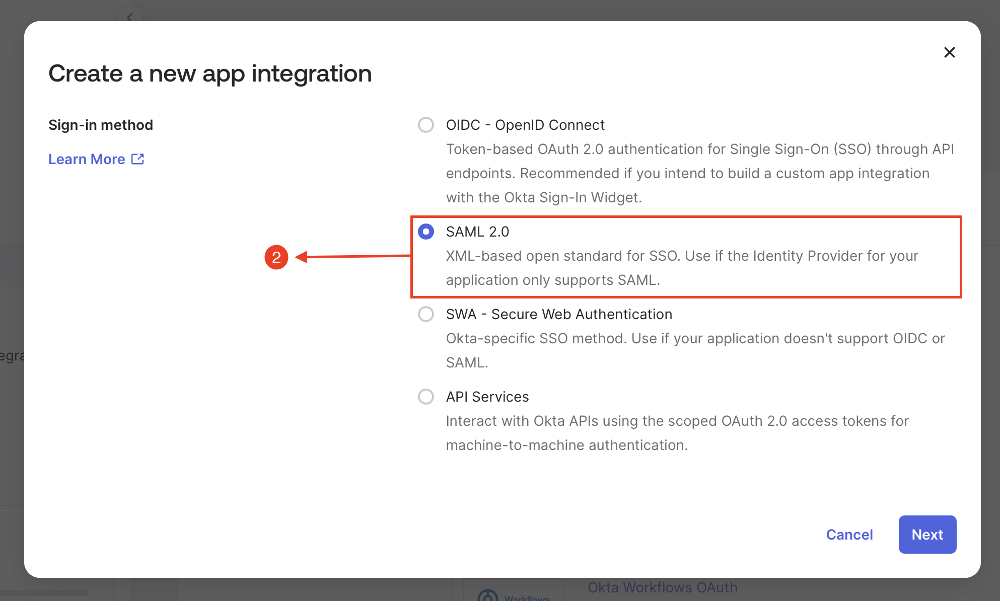

## Step 3: Create SAML Integration - General Settings

- Type Name of the Application, Enter a unique name (e.g., *InstasafeApp*)  
- Upload a logo for easy visual identification of the application in the console  
- Click **Next**

    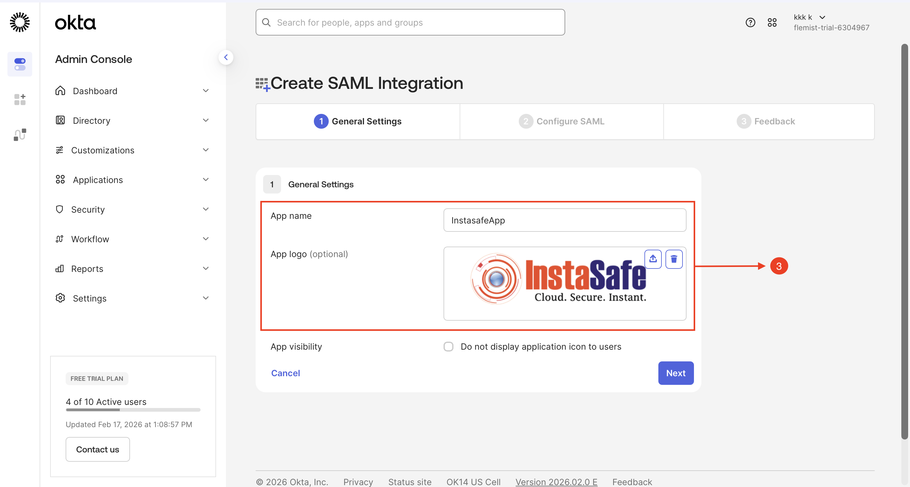

## Step 4: Configure SAML Authentication

- Access the InstaSafe Admin Console and navigate to the **Authentication Profile** section  
- Select **SAML** as the authentication protocol to enable single sign-on (SSO) for the application  
- Download the **Service Provider (SP) Metadata file**, which is required for IdP integration  

The SP Metadata file contains all critical SAML configuration parameters, including:

- Assertion Consumer Service (ACS) URL  
- Entity ID  
- Certificate information  

    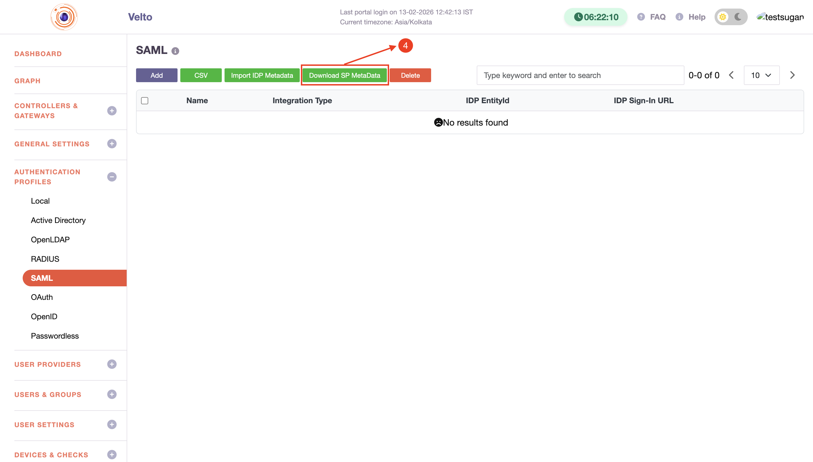

These are necessary for establishing a secure SSO connection.

## Step 5: Create SAML Integration - Configure SAML

- Enter the **Single Sign-On (SSO) URL** obtained from the downloaded metadata file  
- Enter the **Service Provider (SP) Entity ID** as specified in the metadata file  
- Click **Next**  
- Skip the feedback section and click **Finish** to complete the configuration process

    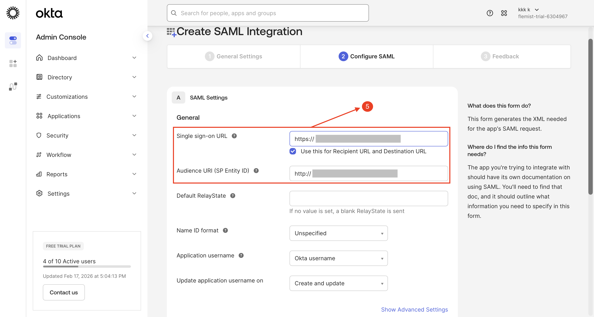

## Step 6: Copy the Metadata details

- Copy the **Metadata URL** and paste it into a web browser  
- The metadata file will be downloaded automatically  

    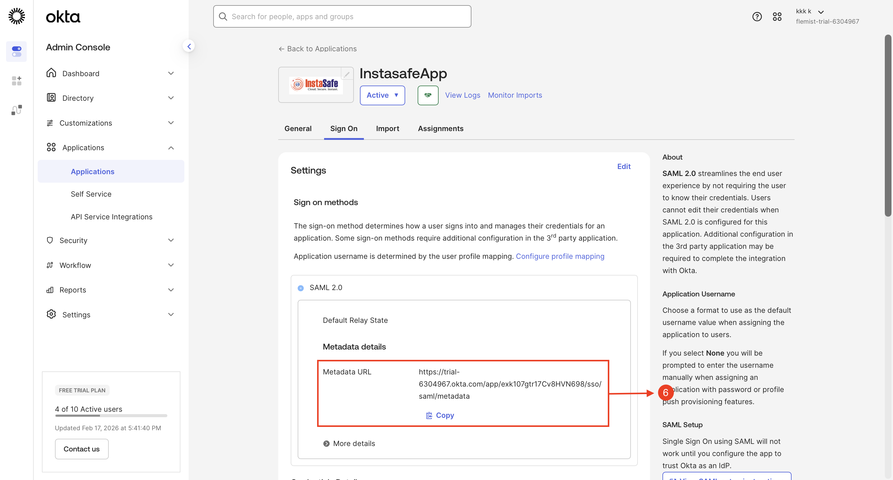

## Step 7: Copy the Metadata details

- Access the InstaSafe Admin Console and navigate to the **Authentication Profile** section  
- Click **SAML** as the authentication protocol  
- Click **Import IDP Metadata**  
- Upload the metadata file, then click **Save** to apply the configuration  

The SP Metadata file contains all critical SAML configuration parameters, including:

- Assertion Consumer Service (ACS) URL  
- Entity ID  
- Certificate information  

    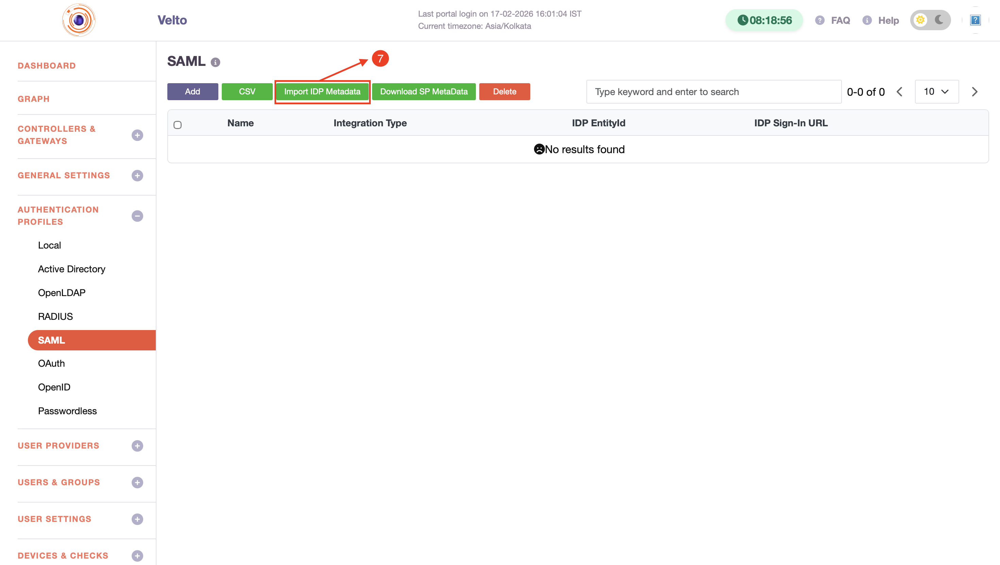

These parameters are necessary for establishing a secure SSO connection.

    
## Step 8: Enable SCIM Provisioning in Okta

- Log in to the Okta Admin Console  
- Navigate to **Applications** and select the created application  
- Go to the **General** tab  
- Click **Edit**, enable **SCIM Provisioning**, and click **Save**

    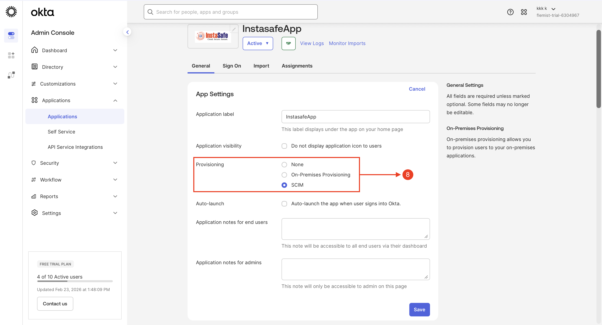

## Step 9: Retrieve Base URL and API Token from InstaSafe

- Log in to the InstaSafe Admin Console  
- Navigate to **User Provider → SCIM Import**  
- Copy the **Base URL** and **API Token** for SCIM provisioning configuration  

    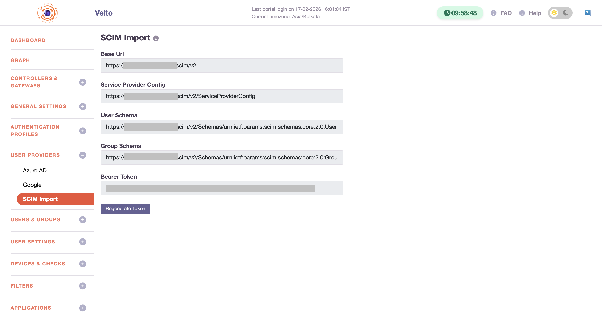

## Step 10: Test SCIM Connector Configuration

- Click **Provisioning** and click **Edit**  
- Paste the URL and Token (Click **Regenerate Token** to get the Token from ISA Console)  
- Select **HTTP Header** in Authentication Mode  
- Click **Test Connector Configuration** to validate the SCIM connection settings

    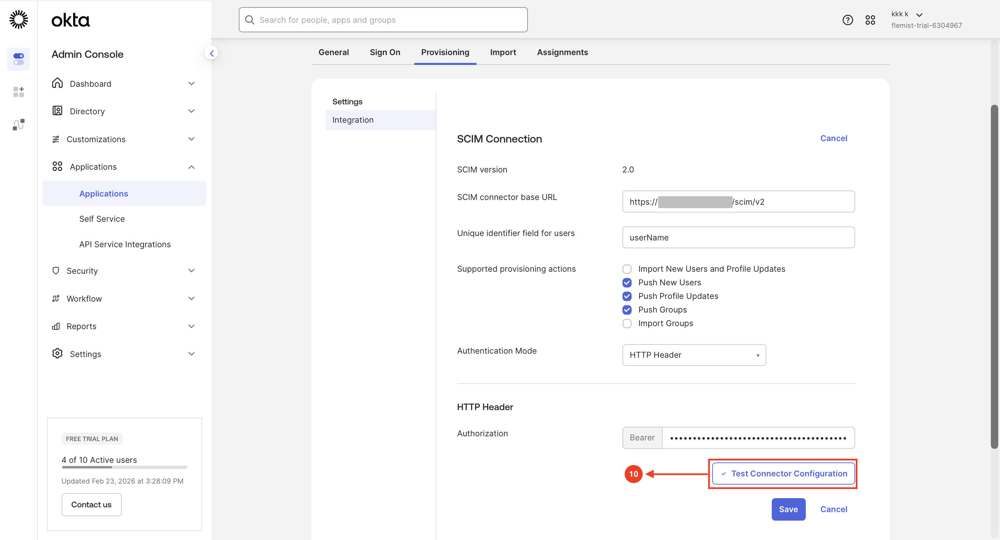

## Step 11: Close Test Confirmation Window

- Click **Close** after confirming the connector is successfully configured.

    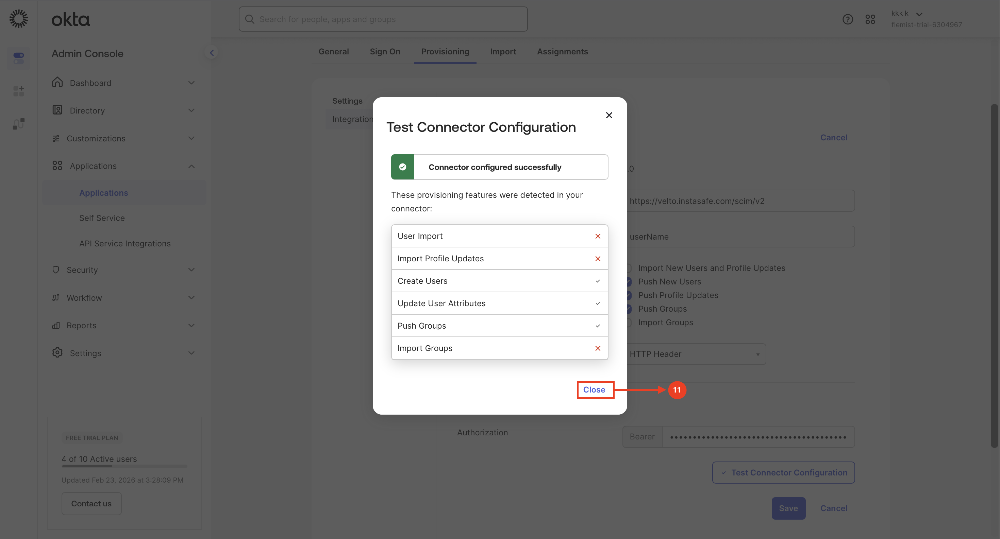

## Step 12: Save SCIM Integration Settings

- Click **Save** to apply and finalize the SCIM provisioning configuration.

    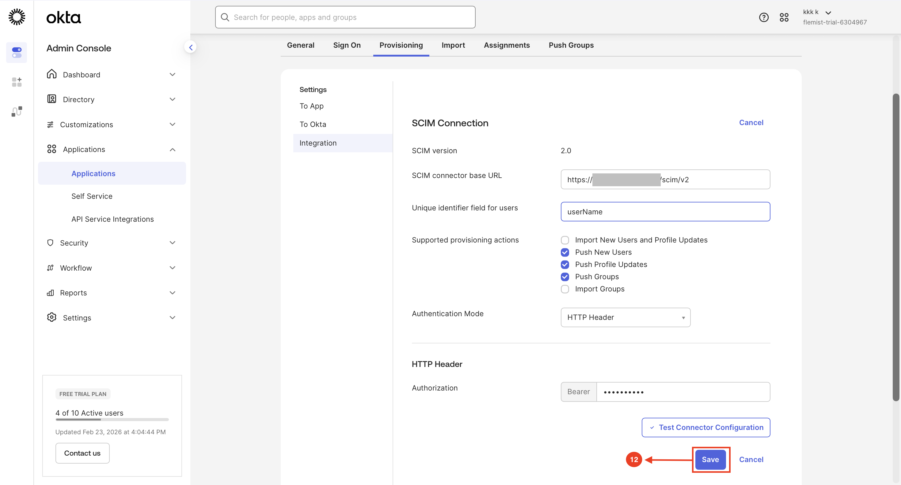

## Step 13: Configure Provisioning Settings

- Navigate to **Provisioning → To App**, click **Edit**, enable the required provisioning options as per the configuration  
- Click **Save** to apply the changes 

    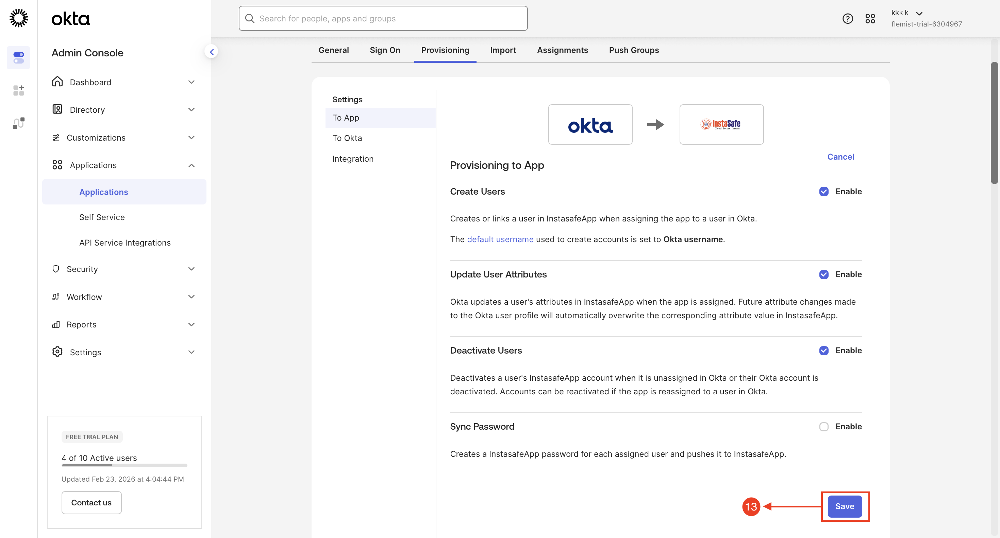

## Step 14: Assign Okta Group to Application

- Navigate to **Applications → Assignments**, select **Assign to Groups**, and add the required group  
- Confirm the group is successfully listed under **Assignments** without errors  

    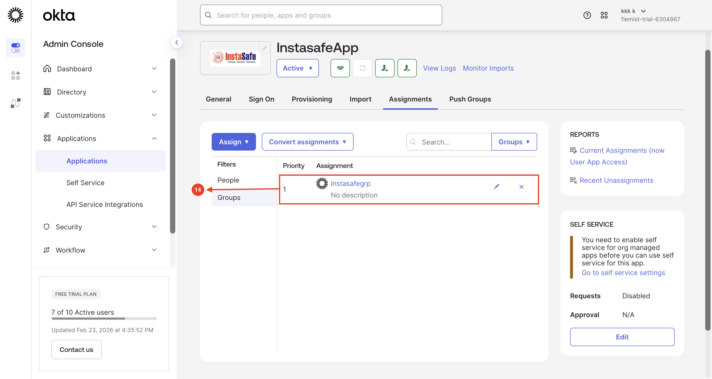

## Step 15: Configure Push Group

- Go to the **Push Groups** tab, select the group using **By name**  
- Save the configuration and verify successful group synchronization status  

    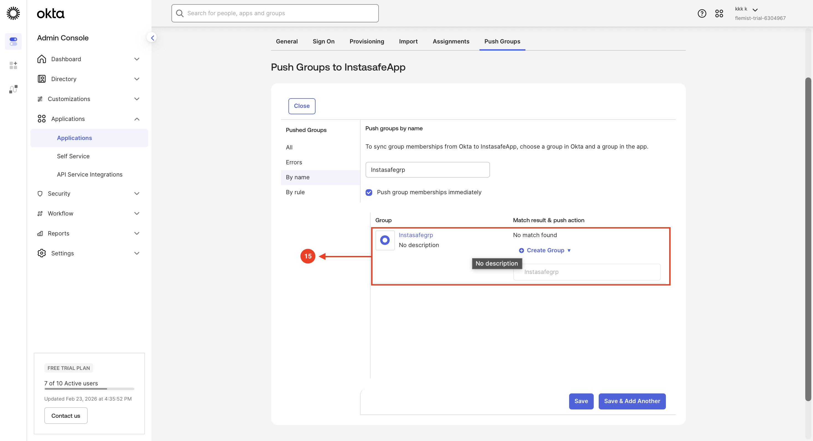

## Step 16: User and Group Provisioning Status Verification

- Access the InstaSafe Admin Console  
- Navigate to the **Events / Logs** section  
- Review **Provisioning Events**  

    

## Step 17: Assign Authentication Profile to User Group

- Access the InstaSafe Admin Console  
- Navigate to **Users & Groups → User Groups**  
- Select the required group and assign the configured **Okta SAML Authentication Profile**  
- Click **Save**

    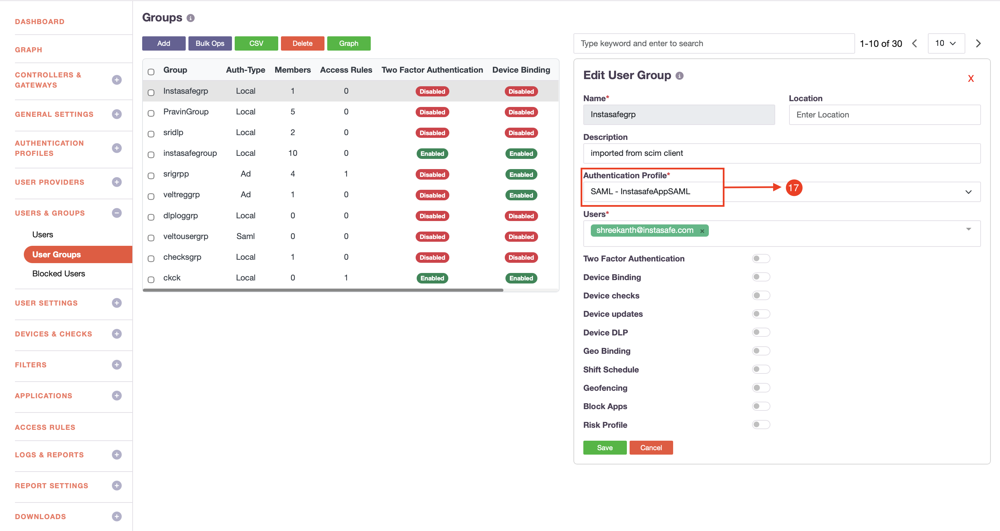