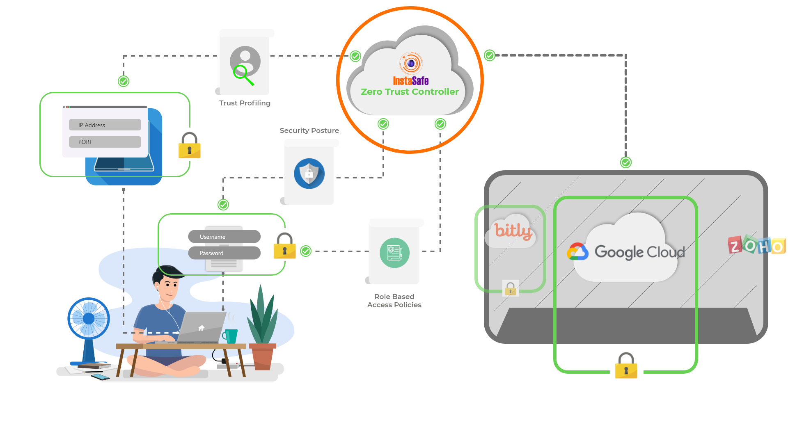

# Welcome to Instasafe Zero Trust Application Access

Instasafe ZTAA is a secure access control management solution that helps enterprises to protect its on-premises as well as cloud based digital assets. ZTAA uses application specific tunnelling and software Defined Perimeters(encryption) to separate access control and data planes. This enables protection to the enterprise network, applications and data from  external threat actors and facilitates secure  roles based application access for employees with two factor authentication. Incorporating the highest standards of Zero Trust Security,organisations can create adaptive role-based access policies for users based on employee role,device being used (trusted or non-trusted), identity, and geographic location, ensuring only verified users have access to resources.

A combination of reduced attack surface and cloud-based deployment model, enhances protection against cybersecurity breach by malicious actors and eliminates significant operational IT overheads of the organisation.

Administrators can more efficiently monitor activity across the network and implement a full range of security features that are easy to scale with organizational growth. 

## How to Use this Documentation?

The documentation ensures a comprehensive coverage of the ZTAA platform and a detailed explanation of the solution from the administrator as well the end user perspective.The [Getting Started section](Zero Trust Application Access/003-gettingstarted.md), is provided which highlights the different sections of the product and their relevance. 

An administrator can undertake  prompt deployment of ZTAA within the organisation, following the articles present in Administrator Guide section. Advanced configurations such as [Single Sign On](Zero Trust Application Access/013-ConfiguringZTAAasSSOwithSAML.md) ,[Multifactor Authentication](Zero Trust Application Access/011-twofactor.md), [Access Control](Zero Trust Application Access/007-accesscontrol.md) policies etc have been provided in Identity Management,Perimeter Management and Access Control Management sections. Further details of these sections are highlighted in the Getting started article

<!--### Feedback

In case you feel the content of the documentation can be improved or notice any mistakes, please [submit your feedback here](https://forms.gle/apSRESG6b8oCNdxb7). -->

## Supported Environment

The Console is supported across latest versions of all major browser i.e Google Chrome, Mozilla Firefox and Internet Explorer.

| Operating System Name | Operating System Version |
|-----------------------|--------------------------|
| **Android** | 7.0 Nougat and Above |
| **IOS**| IOS 8 and Above|
| **Windows** | Windows 7(SP1 and higher), 8,8.1 and 10 |
|**Mac**| Macos 10.14-Mojave, 10.15-Catalina,  11.0-Big Sur |
| **Linux**| Ubuntu 18.04 and Higher|
